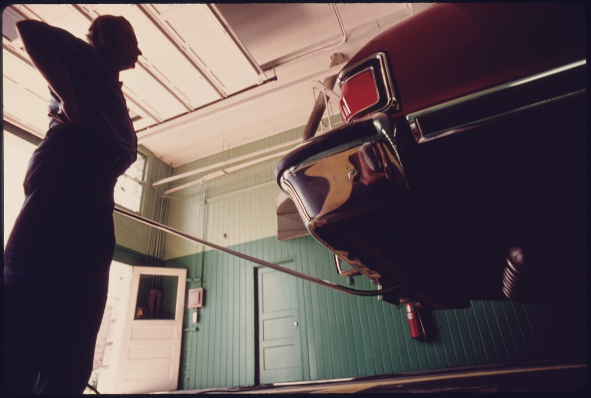
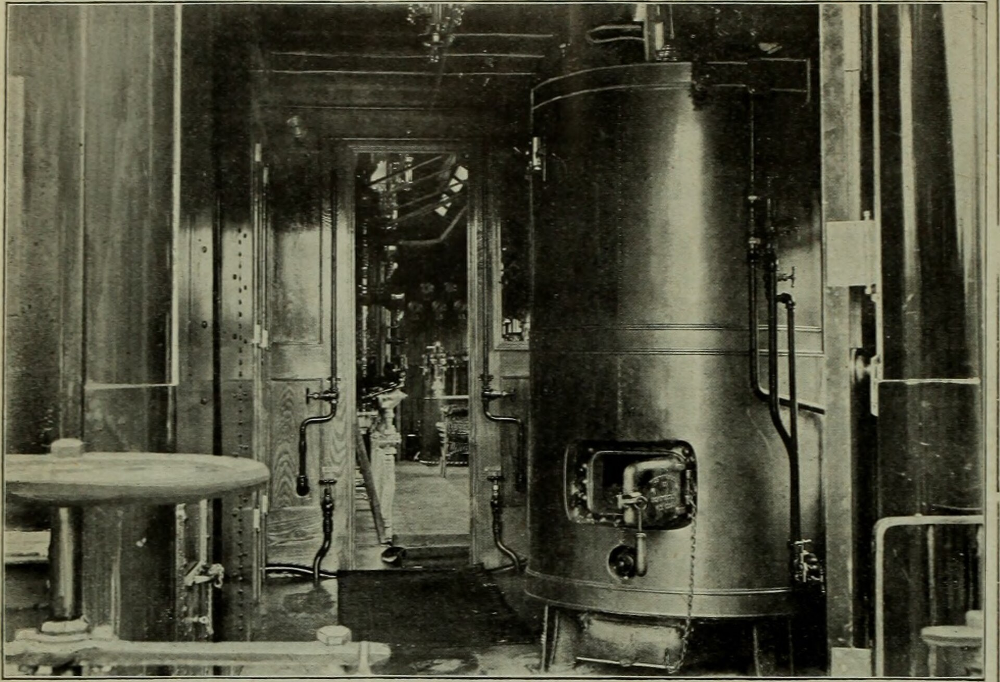

הטסט השנתי לרכב הוא אחד הדברים שכל נהג ישראלי חייב לעבור מדי שנה, אך רבים מגיעים אליו לא מוכנים ונכשלים על תקלות קטנות שאפשר היה לתקן מראש. התשובה הקצרה: אם תבצעו בדיקה מקדימה פשוטה של בלמים, פנסים, צמיגים ומגבים — רוב הסיכויים שתעברו את הטסט השנתי לרכב בבת אחת, בלי לבזבז זמן וכסף על ביקור חוזר.

## מה בודקים בטסט השנתי?

מכון הרישוי בודק את בטיחות הרכב וכשירותו לנסיעה בכביש. אלה המערכות המרכזיות שנבדקות:

- **בלמים** — יעילות הבלימה בכל גלגל, בלם היד ואיזון הבלימה בין הצדדים.
- **פנסים ותאורה** — אורות קרובים ורחוקים, איתותים, פנסי בלימה, אחוריים ותאורת לוחית הרישוי.
- **צמיגים** — עומק סוליה (מינימום חוקי של 1.6 מ"מ), מצב כללי וסימני סדקים או בלאי.
- **מערכת היגוי ומתלים** — רפרוף, בלאי במחברים ודליפות.
- **מערכת פליטה (אגזוז)** — רמות זיהום ובדיקת רעש/דליפות.
- **מרכב ושלדה** — חלודה מבנית, דלתות ומראות.

## אילו תקלות מפילות הכי הרבה רכבים?

מנסיוננו, רוב הכשלונות בטסט אינם נובעים מתקלות חמורות אלא דווקא מדברים קטנים ומעצבנים:

1. **נורה שרופה** — פנס אחורי או איתות שלא עובדים הם הסיבה השכיחה ביותר לכישלון.
2. **מגבים קרועים** — מגב סדוק או לא יעיל נחשב ליקוי בטיחותי.
3. **צמיגים שחוקים** — סוליה מתחת למינימום החוקי תכשיל אתכם מיידית.
4. **נזילת נוזלים** — דליפת שמן או נוזל בלמים מתחת לרכב.
5. **בלמים לא מאוזנים** — רפידות שחוקות בצד אחד.

כל אלה ניתנים לתיקון מהיר וזול יחסית לפני ההגעה למכון.

## כמה זה עולה ומתי חובה לבצע?

אגרת הטסט נקבעת על ידי משרד התחבורה ומתעדכנת מעת לעת (טווח של כמה מאות שקלים, בהתאם לסוג הרכב). רכב פרטי חדש פטור מטסט בשנתיים-שלוש הראשונות, ולאחר מכן מדי שנה. חשוב לבצע את הטסט לפני פקיעת תוקף רישיון הרכב — נהיגה ברכב ללא רישוי בתוקף היא עבירה ועלולה לבטל את כיסוי הביטוח.

## בדיקה מקדימה: טבלת צ'קליסט לפני הטסט

לפני שאתם יוצאים למכון הרישוי, עברו על הרשימה הבאה:

| רכיב | מה לבדוק | עלות תיקון משוערת |
|------|----------|-------------------|
| פנסים ואיתותים | שכל הנורות דולקות | נמוכה |
| מגבים | שאינם קרועים ומנגבים היטב | נמוכה |
| צמיגים | עומק סוליה ולחץ אוויר | בינונית |
| בלמים | אין חריקות או רעד בבלימה | בינונית-גבוהה |
| נוזלים | אין נזילות מתחת לרכב | משתנה |
| מצבר | התנעה תקינה וחיזוקים | נמוכה-בינונית |

## טיפים מעשיים למעבר חלק

- **בצעו בדיקה מקדימה במוסך** — מוסכים רבים מציעים בדיקת טרום-טסט בעלות נמוכה או ללא עלות.
- **הגיעו עם רכב נקי** — בוץ וליכלוך עלולים להסתיר ליקויים ולהקשות על הבדיקה.
- **ודאו שהרכב ריק מחפצים מיותרים** בתא המטען, כדי לאפשר גישה לנקודות הבדיקה.
- **בדקו לחץ אוויר** בצמיגים לפי המומלץ ליצרן — זה משפיע גם על בדיקות נוספות.
- **הביאו מסמכים** — רישיון רכב קודם וביטוח חובה בתוקף.

## מה קורה אם נכשלתם?

אין סיבה לפאניקה. אם נכשלתם, תקבלו פירוט הליקויים, ויש לכם פרק זמן לתקן ולחזור לבדיקה חוזרת (לרוב בעלות מופחתת אם חוזרים תוך תקופה קצרה). תקנו את הליקויים במוסך מוסמך וחזרו — ברוב המקרים מדובר בתיקון פשוט.

הכנה נכונה לטסט השנתי לרכב חוסכת לכם לא רק כסף על ביקורים חוזרים, אלא בעיקר שומרת על בטיחותכם ועל בטיחות שאר המשתמשים בדרך.
