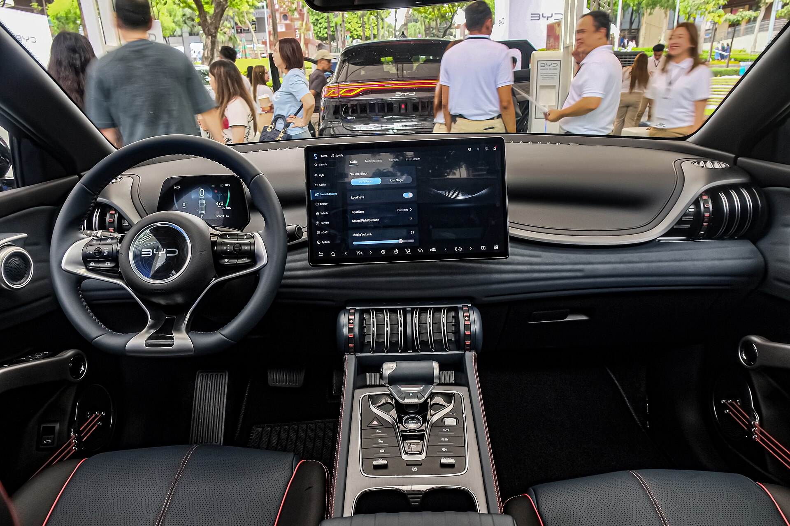

## האם BYD אטו 3 שווה את ההתלהבות?

בשנתיים האחרונות קשה לפספס את BYD אטו 3 בכבישי ישראל — הקרוסאובר החשמלי הקומפקטי של ענקית הרכב הסינית הפך לאחד מרבי המכר בקטגוריה. התשובה הקצרה: **BYD אטו 3 מציע חבילה מאוזנת של טווח סביר, פנים מרווחים, אבזור עשיר ומחיר תחרותי**, ולכן הוא בחירה הגיונית למשפחה שעושה את הצעד הראשון אל העולם החשמלי. יחד עם זאת, הוא לא מושלם, ויש נקודות שחשוב להכיר לפני שסוגרים עסקה.

## עיצוב חיצוני: שמרני אבל נעים

מבחוץ אטו 3 הוא קרוסאובר קומפקטי בגובה נוחות סבירה, עם קווים מעוגלים ופנסי לד חדים. הוא לא צועק "תסתכלו עליי" כמו חלק מהמתחרים, אבל דווקא השמרנות הזאת עובדת לטובתו — זה רכב שנראה טוב גם בעוד כמה שנים. מידותיו ממקמות אותו בין משפחתי קומפקטי לקרוסאובר, מה שהופך אותו לנוח לחניה בעיר הישראלית הצפופה.

## פנים: כאן הוא באמת מפתיע

בתוך התא נמצא אחד היתרונות הגדולים של אטו 3. התכנון שופע פרטים מעניינים — ידיות דלת בעיצוב ייחודי, חומרים רכים למגע, ותחושת מרחב נדיבה בזכות הרצפה השטוחה (יתרון מובנה של פלטפורמה חשמלית ייעודית). במרכז הדשבורד בולט **מסך מגע מסתובב של 12.8 אינץ'** שניתן לסובב בין תצוגה אופקית לאנכית, לצד צג מחוונים דיגיטלי קטן יותר.

מערכת המולטימדיה עשירה ומגיבה, אם כי הממשק לוקח זמן קצר להתרגלות. מרחב הרגליים מאחור נדיב ומתאים היטב למשפחה, ותא המטען בנפח של כ-440 ליטר מספק לשימוש יומיומי ולקניות שבועיות.

## טווח, סוללה וטעינה

אטו 3 מצויד בסוללת **Blade** מסוג לית'יום ברזל פוספט, טכנולוגיה שנחשבת עמידה, יציבה תרמית ובטוחה יחסית. הטווח המוצהר עומד על כ-420 ק"מ במחזור WLTP, אך בנהיגה אמיתית בישראל — בעיקר בשילוב כביש מהיר ומזגן בקיץ — צפו לטווח מעשי נמוך יותר, בסביבות 300-350 ק"מ.

ביכולת הטעינה המהירה אטו 3 אינו אלוף הקטגוריה: הספק טעינה מרבי בזרם ישר נמוך מזה של חלק מהמתחרים החדשים, כך שעצירת טעינה בנסיעה בין-עירונית עשויה להיות ארוכה מעט יותר. לשימוש עירוני יומיומי עם **טעינה ביתית** בלילה — זה כמעט לא מורגש.

## איך זה מרגיש על הכביש?

המנוע החשמלי מספק כ-204 כוחות סוס, מספיק בהחלט לזריזות עירונית ולעקיפות בטוחות. התאוצה ל-100 קמ"ש מתבצעת בכ-7.3 שניות — לא ספורטיבי במיוחד, אבל נעים ומיידי כמו בכל רכב חשמלי.

המתלים מכוילים לנוחות ולא לספורטיביות, מה שמתאים לאופי המשפחתי של הרכב. בכבישים מהירים הוא יציב ושקט, ובעיר הוא קל לתמרון. ההגה קליל יחסית, וחובבי נהיגה דינמית אולי יתגעגעו לקצת יותר תחושת כביש — אבל רוב הנהגים ימצאו בו בדיוק את מה שהם צריכים.

## בטיחות ואבזור

אטו 3 מגיע עם חבילת מערכות בטיחות פעילה עשירה, הכוללת בלימת חירום אוטומטית, בקרת סטייה מנתיב, בקרת שיוט אדפטיבית וזיהוי הולכי רגל. הדגם זכה בדירוג בטיחות גבוה במבחני יורו NCAP, מה שמחזק את אמון הקונה הישראלי.

## טבלת השוואה: BYD אטו 3 מול מתחרים

| פרמטר | BYD אטו 3 | MG ZS EV | קיה e-Niro |
|---|---|---|---|
| טווח (WLTP, מוערך) | כ-420 ק"מ | כ-440 ק"מ | כ-460 ק"מ |
| הספק | כ-204 כ"ס | כ-177 כ"ס | כ-204 כ"ס |
| סוג סוללה | Blade (ברזל פוספט) | ברזל פוספט | ליתיום-יון |
| נפח תא מטען | כ-440 ליטר | כ-470 ליטר | כ-451 ליטר |
| אופי | משפחתי נוח | משפחתי תחרותי | משפחתי בוגר |

## למי אטו 3 מתאים?

BYD אטו 3 הוא בחירה מצוינת למשפחה עירונית שמחפשת **רכב חשמלי ראשון** במחיר שפוי, עם אבזור עשיר, אחריות ארוכה ותחושת מרחב פנימית. מי שעושה הרבה קילומטרים בין-עירוניים וזקוק לטעינה מהירה במיוחד — כדאי שיבחן גם את החלופות. אבל עבור רוב הנהגים הישראלים, זו עסקה חכמה ומאוזנת.
