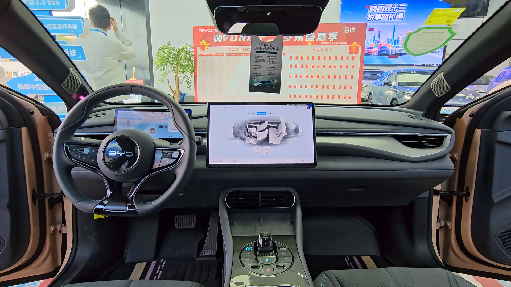

## BYD סיל — על קצה המזלג

**BYD סיל** הוא אחד הרכבים החשמליים המדוברים ביותר שהגיעו לישראל בשנתיים האחרונות, והוא מגיע עם יומרה ברורה: להתמודד ראש בראש מול טסלה מודל 3. מדובר בסדאן חשמלי בגודל בינוני, אלגנטי וארוך, שמשלב טווח נסיעה גדול, ביצועים חזקים וגימור פנים שמפתיע לטובה ביחס למחיר. אחרי שבוע שלם מאחורי ההגה, התשובה הקצרה היא שהסיל הוא רכב בוגר ומגובש הרבה יותר ממה שרבים מצפים ממותג סיני.

## איך זה נוהג?

הרושם הראשון הוא של רכב יציב ומוצק. מרכז הכובד הנמוך, שנובע מהתקנת סוללת ה-**Blade** כחלק מבנה מהתושבת, מעניק תחושת שליטה טובה בסיבובים ומיעוט נטיות גוף. ההיגוי מדויק אך מעט קל מדי בתחושה — נעים לנסיעה עירונית, פחות מעורר בנהיגה ספורטיבית.

בגרסה הדו-מנועית (הנעה כפולה) ההאצה חדה ומיידית: כ-**3.8 שניות** מ-0 ל-100 קמ"ש, מספר שמציב את הסיל בטריטוריה של רכבי ביצועים. גם הגרסה האחורית, החד-מנועית, מספקת תאוצה שגומרת בקלות עם הנהיגה היומיומית בישראל.

### בלימה ונוחות

מערכת הבלמים אפקטיבית, ומערכת הבלימה המתחדשת ניתנת לכיוון בעוצמות שונות. מערכת המתלים מכוילת לכיוון הנוחות — היא בולעת יפה מהמורות ומפגשי כביש, אך בכבישים מתפתלים מרגישים את משקל הרכב הגבוה.

## טווח וטעינה

הטווח המוצהר של BYD סיל נע בין כ-**520 ל-570 ק"מ** בין הגרסאות (לפי מחזור הבדיקה האירופי). בשימוש מעורב ריאלי בישראל, סביר לצפות לכ-400–450 ק"מ אמיתיים, בהתאם לסגנון הנהיגה ולשימוש במזגן.

תמיכה בטעינה מהירה בזרם ישר מאפשרת מילוי מ-30% ל-80% בפרק זמן של כחצי שעה בעמדה מתאימה. בטעינה ביתית בזרם חילופין, טעינת לילה מלאה מכסה בקלות את צורכי השבוע.

## פנים הרכב — הפתעה נעימה

כאן הסיל צובר נקודות רבות. חומרי הגמר איכותיים, הריפודים נעימים למגע והעיצוב מודרני ונקי. במרכז בולט **מסך מגע מסתובב** בגודל כ-15 אינץ' שניתן לסובב בין תצוגה אופקית לאנכית — גימיק שעובד טוב בפועל. לפני הנהג צג דיגיטלי קטן ונקי.

המרחב הפנימי נדיב, במיוחד במושב האחורי, והתא המטען מרווח דיו למשפחה. מצד שני, מערכת המולטימדיה לעיתים מגיבה באיטיות, ותרגום חלק מהתפריטים לעברית עדיין דורש ליטוש.

## BYD סיל מול טסלה מודל 3 — טבלת השוואה

| פרמטר | BYD סיל (דו-מנועי) | טסלה מודל 3 |
|---|---|---|
| סוג | סדאן חשמלי בינוני | סדאן חשמלי בינוני |
| האצה 0–100 קמ"ש | כ-3.8 שניות | כ-4.4 שניות (הנעה כפולה) |
| טווח מוצהר | כ-520–570 ק"מ | כ-500–620 ק"מ |
| סוללה | Blade (ליתיום ברזל פוספט) | ליתיום-יון |
| מסך מרכזי | כ-15 אינץ' מסתובב | כ-15 אינץ' אופקי |
| אופי | יוקרתי ונוח | ספורטיבי וטכנולוגי |

## למי הסיל מתאים?

**BYD סיל** מתאים במיוחד למי שמחפש סדאן חשמלי מרווח, חסכוני ונוח, עם תחושת פרימיום במחיר תחרותי. הוא פחות יתאים למי שמחפש חוויית נהיגה חדה וממוקדת נהג — שם טסלה מודל 3 עדיין שומרת על יתרון קל.

בסופו של דבר, הסיל הוא עדות מצוינת לכמה רחוק הגיעה תעשיית הרכב הסינית. הוא לא רק "חלופה זולה" — הוא מוצר מגובש שעומד בזכות עצמו, ומצדיק בהחלט נסיעת מבחן לפני החלטה על רכב חשמלי חדש בישראל.
