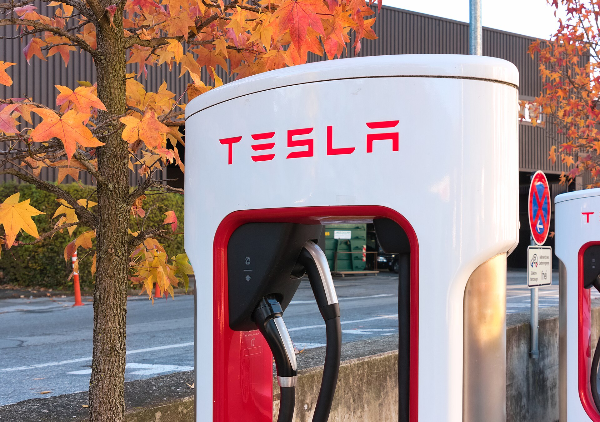

## טסלה מודל Y החדשה — מה השתנה?

**טסלה מודל Y** בגרסתה המרעננת, המכונה בשם הקוד "ג'וניפר", הגיעה לישראל והיא אחת החשמליות המדוברות של השנה. מדובר בשדרוג אמצע-מחזור משמעותי: עיצוב חזית ואחור חדשים, שיפור ניכר בבידוד הרעשים ובנוחות המתלים, ופנים שקטים ומוקפדים יותר. התשובה הקצרה — זו אותה מודל Y שאהבנו, אבל מלוטשת ובוגרת יותר, ועדיין מהבחירות המובילות בקטגוריית הקרוסאוברים החשמליים.

השינוי הבולט ביותר מורגש דווקא בנהיגה היומיומית. טסלה השקיעה בבידוד אקוסטי, בזכוכית עבה יותר ובכוונון מתלים מחדש — והתוצאה היא רכב שקט ונינוח יותר בכביש המהיר, תחום שבו הדור הקודם ספג ביקורת.

## עיצוב פנים וטכנולוגיה

תא הנוסעים ממשיך את גישת המינימליזם של טסלה: מסך מרכזי גדול שמנהל כמעט את כל פונקציות הרכב, היעדר לוח מחוונים מאחורי ההגה, ותחושת מרחב ואוורור בזכות גג הזכוכית הפנורמי. בגרסה החדשה נוסף מסך קטן לנוסעים מאחור, שדרוג בחומרי הגימור ותאורת סביבה מרשימה.

מערכת המולטימדיה של טסלה נותרה מהמהירות והחלקות בשוק, עם עדכוני תוכנה אלחוטיים (OTA) שממשיכים לשפר את הרכב לאורך זמן. חובבי הפיזיות של כפתורים אולי יתגעגעו למתגים, אך מי שמתרגל לממשק מגלה מערכת אינטואיטיבית.

### מרחב ופרקטיות

מודל Y נשארת אלופת הנפח בקטגוריה: תא מטען אחורי גדול, תא קדמי (פראנק) נוסף, ומושב אחורי מתקפל שמאפשר גמישות רבה. למשפחה ישראלית טיפוסית מדובר ברכב פרקטי במיוחד לנסיעות ארוכות ולקניות שבועיות.

## טווח, סוללה וטעינה

זה הפרק שמעניין את הקונה הישראלי. הטווח המוצהר של **טסלה מודל Y** החדשה נע, בהתאם לגרסה, בטווח של כ-460 עד 600 ק"מ במחזור הבדיקה האירופי. בשימוש אמיתי, בכביש מהיר ובמזג אוויר קיצי עם מזגן פעיל, כדאי לתכנן טווח מעשי צנוע יותר.

יתרון הדגל של טסלה נותר **רשת הסופר-צ'ארג'ר**: טעינה מהירה שמאפשרת הוספת טווח משמעותי בכ-20 עד 30 דקות, לצד פריסה נוחה של עמדות. בטעינה ביתית בזרם חילופין, הטעינה המלאה מתבצעת בדרך כלל במהלך הלילה.

## ביצועים ונהיגה

גם בגרסאות הבסיסיות מודל Y מספקת תאוצה חדה ותחושת נהיגה ערה. גרסאות ההנעה הכפולה (Dual Motor) מוסיפות אחיזה ודחף בכל תנאי. ההיגוי מדויק, מרכז הכובד הנמוך תורם ליציבות, והבלימה האיטית (רה-גנרציה) מאפשרת נהיגה בדוושה אחת ברוב המצבים.

## טבלת השוואה: מודל Y מול מתחרות בישראל

| פרמטר | טסלה מודל Y | סקודה אניאק | קיה EV6 |
|---|---|---|---|
| קטגוריה | קרוסאובר חשמלי | קרוסאובר חשמלי | קרוסאובר חשמלי |
| טווח מוצהר (הערכה) | כ-460-600 ק"מ | כ-500-560 ק"מ | כ-500-530 ק"מ |
| רשת טעינה ייעודית | סופר-צ'ארג'ר | רשת ציבורית | רשת ציבורית |
| נפח תא מטען | גדול מאוד | גדול | בינוני-גדול |
| אופי | ספורטיבי-טכנולוגי | נוחות ומרחב | עיצוב וביצועים |

*הנתונים הם הערכות כלליות ועשויים להשתנות בין גרסאות ושנתונים.*

## כמה זה עולה בישראל?

המחיר של **טסלה מודל Y** בישראל נע בדרך כלל בטווח של מאות אלפי שקלים, בהתאם לגרסה (הנעה יחידה או כפולה), לצבע ולמבצעי היבואן. חשוב לזכור כי מיסוי הרכב החשמלי בישראל נמצא במגמת עלייה הדרגתית, ולכן כדאי לבדוק את המחיר העדכני והטבות המס במועד הרכישה בפועל.

## למי מתאימה מודל Y החדשה?

מודל Y מתאימה למי שמחפש קרוסאובר חשמלי מרווח, מהיר וטכנולוגי, שמתבסס על רשת טעינה אמינה ונוחה לנסיעות בין-עירוניות. מי שמעדיף ממשק פיזי עם כפתורים מסורתיים, או תא נוסעים חמים ומסורתי יותר, אולי ימצא חלופות מתאימות יותר. אך עבור רבים, השילוב של ביצועים, מרחב, עדכוני תוכנה ורשת הטעינה הופך את מודל Y לבחירה חשמלית מובילה.
