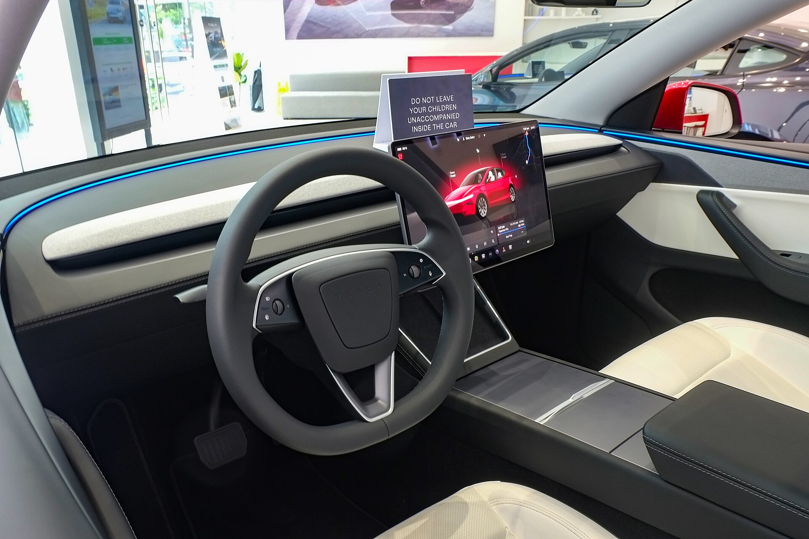

טסלה מודל Y החדשה, המכונה בשם הפנימי "ג'וניפר", מגיעה לישראל ומביאה איתה את השדרוג המשמעותי הראשון לקרוסאובר החשמלי הנמכר של המותג. מדובר בעדכון אמצע-חיים מקיף שמתמקד בעיצוב חיצוני מרוענן, תא נוסעים שקט ונעים יותר ושיפורים קטנים אך מורגשים בנסועה ובטווח. אם חיכיתם לדור הבא של מודל Y — הוא כבר כאן.

## מה חדש בטסלה מודל Y החדשה?

השינוי הראשון שקופץ לעין הוא החזית. במקום הפרצוף המעוגל והמוכר, מקבלת טסלה מודל Y החדשה פס תאורה רציף לרוחב החזית ופנסים ראשיים דקים יותר, בהשראת מודל 3 המעודכנת. גם החלק האחורי זכה לרצועת תאורה חדשה המשתרעת לכל רוחב הרכב, מה שמעניק לדגם מראה רחב ועדכני יותר.

מעבר לאסתטיקה, טסלה השקיעה הפעם בדברים שמרגישים ביומיום: זכוכית עבה יותר, אטמים משופרים ובידוד אקוסטי מוקפד שהופכים את תא הנוסעים לשקט משמעותית במהירויות גבוהות. זו בדיוק הנקודה שעליה נמתחה ביקורת בדור הקודם.

### פנים הרכב — מינימליזם שהתבגר

התא ממשיך בקו המינימליסטי המזוהה עם טסלה, אך עם שדרוגי איכות חומרים, תאורת אווירה מרהיבה וריפודים נעימים יותר. מסך המגע המרכזי נותר מרכז השליטה היחיד כמעט, ונוסף מסך קטן לנוסעים האחוריים לשליטה במיזוג ובמולטימדיה. ההגה מאבד את ידיות ההילוכים לטובת שליטה דרך המסך — מהלך שמחלק דעות.

## כמה טווח יש לטסלה מודל Y החדשה?

הטווח המוצהר השתפר קלות בזכות שיפורים אווירודינמיים וייעול מערכת ההנעה. הגרסאות העיקריות — טווח ארוך והנעה כפולה — מציעות טווח מוצהר של מאות קילומטרים בטעינה אחת, מספיק בנוחות לרוב הישראלים לשבוע נסיעות עירוני. בפועל, הטווח האמיתי תלוי כמובן בסגנון נהיגה, מזג אוויר ושימוש במיזוג.

יתרון מרכזי שנשמר הוא הגישה לרשת העמדות המהירות של טסלה (סופרצ'רג'ר), שממשיכה להתרחב בישראל ומאפשרת טעינה נוחה גם בנסיעות ארוכות בין ערים.

## השוואה: מודל Y החדשה מול הדור הקודם

| פרמטר | מודל Y קודמת | מודל Y ג'וניפר |
|---|---|---|
| עיצוב חזית | פנסים מעוגלים | פס תאורה רציף, פנסים דקים |
| בידוד רעשים | בינוני | משופר משמעותית |
| מסך אחורי | אין | מסך לנוסעים האחוריים |
| נסועה | נוקשה יחסית | מכוילת מחדש, נוחה יותר |
| טווח מוצהר | מאות ק"מ | שיפור קל |

## למי מתאימה טסלה מודל Y החדשה?

המודל Y פונה למשפחות ולנהגים שמחפשים רכב חשמלי מרווח, מהיר וחסכוני בתחזוקה. תא המטען הגדול, התא האחורי הנוח ומערכת ההנעה החזקה הופכים אותו למועמד טבעי כרכב משפחתי ראשי. השדרוגים בנוחות ובשקט מכוונים בדיוק למי שהיסס בגלל הנסועה הקשיחה של הדור הקודם.

מנגד, מי שמעדיף בקרה פיזית מסורתית — ידיות הילוכים, כפתורים ומחווני מידע מול הנהג — עשוי להתקשות עם הגישה הדיגיטלית המוחלטת של טסלה, שבה כמעט הכול עובר דרך המסך המרכזי.

## כמה תעלה טסלה מודל Y החדשה בישראל?

המחיר הסופי בישראל צפוי להיות מושפע מהעלאת מס הקנייה על רכבים חשמליים הנכנסת לתוקף ב-2026, מגמה שמייקרת בהדרגה את החשמליות בשוק המקומי. טווח המחירים הצפוי נע סביב מאות אלפי שקלים בהתאם לגרסה ולרמת האבזור. מומלץ לבדוק מול היבואן את המחיר העדכני ואת מועדי האספקה, שעשויים להשתנות לפי הביקוש.

בשורה התחתונה, טסלה מודל Y החדשה אינה מהפכה אלא התבגרות מחושבת: אותו רכב מצוין שהכרנו, עכשיו שקט יותר, נעים יותר ומעוצב בצורה עדכנית. עבור קהל החשמליות הישראלי, זו עדיין אחת האפשרויות המשתלמות והמושלמות ביותר בקטגוריה.
