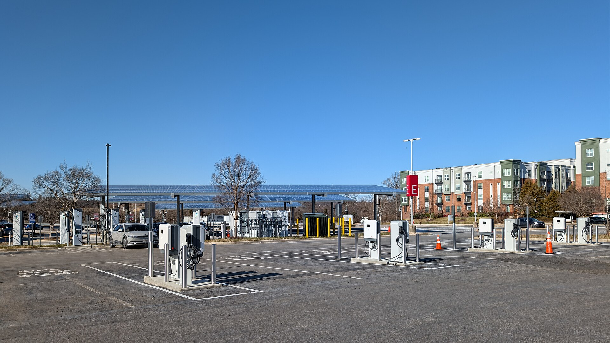

**טעינה מהירה לרכב חשמלי** היא הדרך למלא את רוב הסוללה תוך זמן קצר בעמדת זרם ישר (DC) בכביש הבין-עירוני. בפועל, מרבית הרכבים החשמליים המודרניים עוברים מ-10% ל-80% טעינה בכ-20 עד 40 דקות — פחות או יותר כמו הפסקת קפה אחת. החלק החשוב להבנה הוא שהמספר על שלט העמדה (למשל 150 קילוואט) אינו בהכרח מה שתקבלו בפועל, והקצב משתנה לאורך כל הטעינה.

## מה ההבדל בין טעינה מהירה לטעינה רגילה?

ישנם שני סוגי טעינה עיקריים. **טעינה בזרם חילופין (AC)** היא זו שמתבצעת בעמדה ביתית או בחניונים, בהספק טיפוסי של 7 עד 22 קילוואט, ומתאימה לטעינת לילה שלמה. **טעינה מהירה בזרם ישר (DC)** מתבצעת בעמדות ציבוריות בכביש, בהספקים של 50 ועד 350 קילוואט, ונועדה למלא את הסוללה במהירות באמצע נסיעה.

ההבדל נובע מכך שבטעינה מהירה הזרם הישר נכנס ישירות לסוללה ועוקף את הממיר הפנימי של הרכב, שמגביל את הקצב בטעינת AC.

## כמה זמן באמת לוקחת טעינה מהירה?

התשובה תלויה בשלושה גורמים עיקריים: הרכב, העמדה ומצב הסוללה. גם אם העמדה מספקת 150 קילוואט, רכב שההספק המרבי שלו הוא 100 קילוואט לא יחרוג מכך. בפועל, הנה טווחים אופייניים לטעינה מ-10% ל-80%:

| דגם | הספק טעינה מרבי (בקירוב) | זמן מ-10% ל-80% |
|------|------------------------|------------------|
| טסלה מודל 3 | כ-170 קילוואט | כ-25-30 דקות |
| יונדאי איוניק 5 | כ-230 קילוואט | כ-18-25 דקות |
| סקודה אניאק | כ-135 קילוואט | כ-28-35 דקות |
| קיה EV3 | כ-100-130 קילוואט | כ-30-40 דקות |
| וולוו EX30 | כ-150 קילוואט | כ-25-30 דקות |

המספרים הם הערכות כלליות בתנאים אידיאליים. בשטח, מזג אוויר קר, סוללה חמה מדי או עמדה עמוסה יכולים להאריך את הזמן.

## למה הטעינה מאטה מעל 80%?

זו אינה תקלה אלא הגנה מכוונת. **עקומת הטעינה** של רכב חשמלי אינה קו ישר: ההספק הגבוה ביותר מתקבל כשהסוללה ריקה יחסית, והוא יורד בהדרגה ככל שהיא מתמלאת. מעל 80% הקצב צונח משמעותית כדי להגן על תאי הסוללה מפני בלאי ומחום.

משמעות הדבר פרקטית: בנסיעה ארוכה כדאי לנתק את הרכב סביב 80% ולהמשיך, במקום לחכות דקות ארוכות עבור האחוזים האחרונים. הזמן שתחסכו שווה הרבה יותר מהטווח הנוסף.

## האם טעינה מהירה מזיקה לסוללה?

טעינה מהירה מדי פעם אינה מזיקה באופן מורגש. הסוללות והמערכות המנהלות אותן תוכננו בדיוק לשם כך. עם זאת, **שימוש יומיומי בלעדי בטעינה מהירה** עלול להאיץ במעט את הבלאי לאורך שנים, בעיקר בשל החום הנוצר. ההמלצה הרווחת: להשתמש בטעינה ביתית איטית לשגרה היומית, ולשמור את העמדות המהירות לנסיעות בין-עירוניות.

## טיפים לטעינה מהירה חכמה יותר

- **חממו את הסוללה מראש:** רכבים רבים מאפשרים חימום מקדים של הסוללה לפני הגעה לעמדה. סוללה בטמפרטורה מיטבית נטענת מהר יותר, בעיקר בבוקר חורפי.
- **הגיעו עם סוללה נמוכה:** אם תגיעו לעמדה עם 50%, תיהנו מעט מאוד מהספק השיא. ההגעה עם אחוזים נמוכים מנצלת את החלק המהיר של העקומה.
- **בדקו את הספק הרכב, לא רק העמדה:** אין טעם לחפש עמדה של 350 קילוואט אם הרכב שלכם מוגבל ל-120.
- **הימנעו מעמדות עמוסות:** כשעמדה מחלקת הספק בין שני רכבים, הקצב עשוי לרדת.

## שורה תחתונה

טעינה מהירה הפכה את הרכב החשמלי למעשי גם לנסיעות ארוכות בישראל. כל עוד מבינים שהקצב אינו קבוע, שהחלק היעיל ביותר הוא עד 80%, ושטעינה ביתית עדיפה לשגרה — חוויית הבעלות הופכת לפשוטה ונוחה בהרבה.
