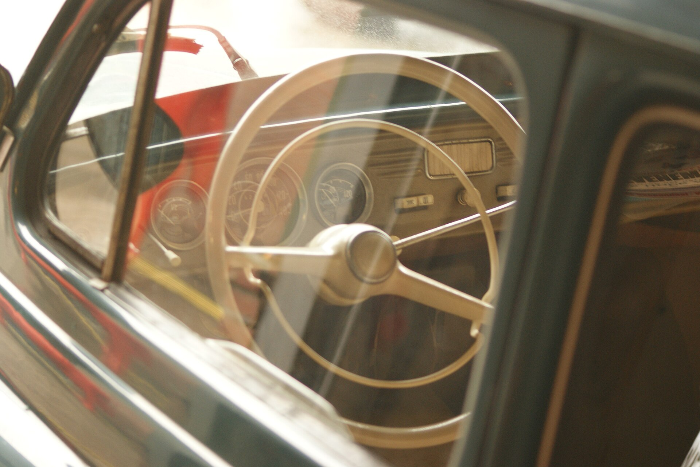

סקודה אוקטביה היא כבר שנים אחת התשובות הברורות ביותר לשאלה "איזו משפחתית לקנות בישראל". היא מציעה שילוב נדיר של מרחב פנימי נדיב, תא מטען ענק, נהיגה בוגרת וחסכון בדלק — והכל במחיר שנשאר הגיוני ביחס למתחרים. במבחן הדרך הזה בדקנו האם הדור הנוכחי עדיין מצדיק את מעמד רב-המכר.

## מה מייחד את סקודה אוקטביה?

היתרון הבולט ביותר של סקודה אוקטביה הוא הניצול החכם של המקום. למרות שהיא ממצבת את עצמה כמשפחתית בגודל בינוני, הישיבה מאחור רחבה ונוחה גם לשלושה נוסעים, ומרחב הרגליים מתחרה ברכבים מדרגה גבוהה יותר. תא המטען בגרסת הליפטבק מגיע לכ-600 ליטר, ובגרסת הקומבי (סטיישן) הוא קופץ משמעותית ומתאים למשפחות שנוסעות עם ציוד רב.

העיצוב החיצוני שמרני ואלגנטי, בלי להגזים. הקווים הנקיים והחזית המוכרת של סקודה משדרים בגרות, וזו בדיוק הקהל שאליו האוקטביה פונה — מי שמחפש רכב שמשרת היטב לאורך שנים בלי דרמות.

## איך זה מרגיש לנהוג בסקודה אוקטביה?

על הכביש האוקטביה מפגינה אופי רגוע ומיוצב. מנוע הבנזין הטורבו של 1.5 ליטר מספק הספק נאה בשילוב תיבת אוטומט כפולת-מצמד, והתגובות חלקות ברוב מצבי הנהיגה. זו לא מכונית ספורטיבית, אבל היא בטוחה ונעימה — בדיוק מה שמשפחה מצפה ממנה.

הבידוד האקוסטי בתא הנוסעים טוב, במיוחד בנסיעה בינעירונית, והמתלים מצליחים לבלוע את רוב מהמורות הכביש הישראלי. החסכון בדלק הוא אחד הקלפים החזקים: בנהיגה מעורבת קל להגיע לצריכה מרשימה, במיוחד הודות למערכת כיבוי צילינדרים חכמה בגרסאות המתאימות.

## טכנולוגיה ובטיחות

בתוך התא ממתין מסך מולטימדיה גדול וברור, עם ממשק שהשתפר מאוד בדורות האחרונים. יש תמיכה אלחוטית בחיבור הטלפון, לוח מחוונים דיגיטלי בגרסאות הגבוהות, ומגוון תאי אחסון חכמים שסקודה מפורסמת בהם — כולל המטרייה המובנית בדלת וגרדן לשמשה.

בתחום הבטיחות, אוקטביה מציעה מערך עשיר של מערכות עזר לנהג: בלימת חירום אוטונומית, בקרת שיוט אדפטיבית, שמירת נתיב, זיהוי הולכי רגל ומצלמת רוורס. בגרסאות הגבוהות מתווספות מערכות מתקדמות יותר שהופכות את הנסיעות הארוכות לנינוחות הרבה יותר.

## טבלת השוואה: סקודה אוקטביה מול מתחרות

| פרמטר | סקודה אוקטביה | טויוטה קורולה | פולקסווגן גולף |
|---|---|---|---|
| נפח תא מטען (ליפטבק) | כ-600 ליטר | כ-470 ליטר | כ-380 ליטר |
| סוג הנעה עיקרי | בנזין טורבו / היברید | היברید | בנזין טורבו / היברید |
| אופי נהיגה | בוגר ונוח | חסכוני ושקט | ספורטיבי יותר |
| מרחב פנימי | מרווח מאוד | טוב | סביר |
| ערך משתמר | טוב | מצוין | טוב |

## למי מתאימה סקודה אוקטביה?

אם אתם מחפשים משפחתית אחת שתעשה הכל — נסיעות עירוניות יומיומיות, טיולים משפחתיים עם מטען רב, ונסיעות ארוכות בנוחות — סקודה אוקטביה היא מועמדת מצוינת. היא פחות מתאימה למי שמחפש ריגושי נהיגה או דמות סוחפת, אבל מצטיינת בדיוק במה שחשוב למשפחה: מרחב, אמינות, חסכון ושקט נפשי.

גם בשוק יד שנייה האוקטביה שומרת על ביקוש גבוה, מה שתורם לערך המשתמר ומקל על המכירה בעתיד. זו אחת הסיבות שהיא נשארה רב-מכר עקבי בישראל לאורך דורות.

## סיכום

סקודה אוקטביה ממשיכה להוכיח מדוע היא אחת המשפחתיות הנבונות ביותר בשוק הישראלי. היא אינה המרשימה ביותר בשום פרמטר בודד, אבל היא מצטיינת באיזון הכולל — וזה בדיוק מה שהופך אותה לבחירה חכמה למשפחות שמחפשות רכב אחד שעושה הכל היטב.
