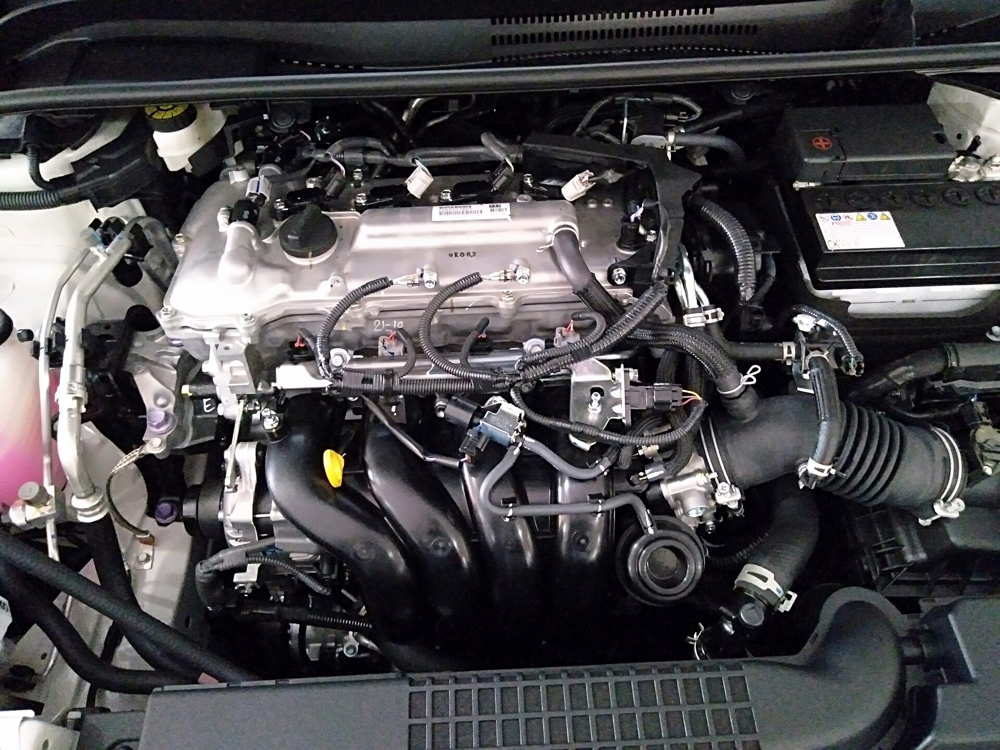

אחת השאלות הנפוצות ביותר של בעלי רכב בישראל היא כל כמה זמן צריך **להחליף שמן מנוע**. התשובה הקצרה: ברוב הרכבים המודרניים המצוידים בשמן סינתטי מלא, מומלץ להחליף שמן כל **10,000 עד 15,000 קילומטר, או אחת לשנה** — המוקדם מביניהם. עם זאת, אופי הנהיגה בישראל, החום בקיץ והנסיעות העירוניות הקצרות עשויים לחייב החלפה תכופה יותר.

## למה בכלל חשוב להחליף שמן מנוע?

שמן המנוע הוא ה"דם" של הרכב. הוא מסוך את החלקים הנעים, מסייע בקירור, מנקה משקעים ומונע חלודה. עם הזמן השמן מתבלה: התוספים שבו מתכלים, הוא מאבד מצמיגותו ונאסף בו לכלוך. שמן ישן ושחוק מאבד מיכולת הסיכה שלו ומאיץ בלאי של רכיבים יקרים כמו מיסבים, טבעות בוכנה ושרשרת תזמון.

הזנחה של החלפת השמן היא אחת הסיבות הנפוצות לתקלות מנוע חמורות — תיקון שעלול לעלות עשרות אלפי שקלים, לעומת החלפת שמן ששווה כמה מאות שקלים בלבד.

## כל כמה זמן להחליף שמן לפי סוג השמן

סוג השמן הוא הגורם המשמעותי ביותר בקביעת מרווח ההחלפה. הנה טבלת השוואה כללית:

| סוג שמן | מרווח החלפה מומלץ | למי מתאים |
|---|---|---|
| מינרלי | 5,000–7,000 ק"מ | רכבים ישנים ומנועים פשוטים |
| סינתטי חלקי | 7,000–10,000 ק"מ | רכבים בני עשר שנים ומעלה |
| סינתטי מלא | 10,000–15,000 ק"מ | רוב הרכבים החדשים |
| שמן ייעודי ליצרן | לפי ספר הרכב | מנועים מודרניים ועתירי טכנולוגיה |

**חשוב:** המספרים הם כלל אצבע בלבד. ההמלצה הרשמית של יצרן הרכב, המופיעה בספר הרכב, תמיד גוברת. יצרנים מסוימים ממליצים על מרווחים ארוכים יותר בתנאי נהיגה אידיאליים.

## למה בישראל כדאי להחליף שמן לעיתים קרובות יותר?

תנאי הנהיגה בישראל נחשבים ל"תנאי נהיגה קשים" לפי הגדרות רבות של יצרנים, וזאת מכמה סיבות:

- **חום קיצוני בקיץ** — טמפרטורות גבוהות מאיצות את התבלות השמן.
- **נהיגה עירונית קצרה** — נסיעות קצרות אינן מאפשרות למנוע להגיע לטמפרטורת העבודה האידיאלית, מה שגורם להצטברות לחות ומשקעים.
- **פקקים ועצירות תכופות** — העומס על המנוע בנהיגה עצור-סע גבוה.
- **אבק וחול** — תורמים ללכלוך מהיר יותר של השמן והמסננים.

בגלל זה, גם אם ספר הרכב מתיר 15,000 ק"מ, רבים בוחרים להחליף שמן כל 10,000 ק"מ לשקט נפשי ולאריכות ימים של המנוע.

## סימנים שמגיע הזמן להחליף שמן

גם אם לא הגעתם למרווח הקילומטרים, שימו לב לסימנים הבאים:

1. **נורת אזהרה** של לחץ שמן או טיפול תקופתי בלוח המחוונים.
2. **שמן כהה וסמיך** על מדיד השמן (דיפסטיק) — שמן חדש הוא ענברי ושקוף יחסית.
3. **רעשי מנוע מוגברים** או תקתוק — סימן לסיכה לקויה.
4. **ריח שרוף** בתא הנוסעים.
5. **צריכת שמן גבוהה** — אם אתם צריכים להוסיף שמן לעיתים קרובות.

## האם להחליף גם את מסנן השמן?

כן, בהחלט. את **מסנן השמן** יש להחליף בכל החלפת שמן. מסנן ישן אוגר לכלוך ואינו מסנן ביעילות, ובמקרים קיצוניים עלול להיחסם ולפגוע בזרימת השמן. העלות של מסנן חדש זניחה ביחס לחשיבותו.

## כמה עולה החלפת שמן בישראל?

המחיר משתנה לפי סוג השמן, כמות השמן שהמנוע דורש ומקום הביצוע. באופן כללי, החלפת שמן מלאה כולל מסנן נעה בטווח של כמה מאות שקלים — זולה יותר במוסך פרטי ויקרה יותר במעבדת היצרן. שמן סינתטי איכותי עולה יותר, אך האריכות שהוא מעניק למנוע מצדיקה את ההשקעה.

טיפ לחיסכון: אפשר לרכוש שמן ומסנן מקוריים ולהביא אותם למוסך, אך ודאו מראש שהמוסך מסכים לכך ושהשמן תואם במדויק למפרט היצרן.

## שורה תחתונה

החלפת שמן מנוע היא הטיפול הזול והחשוב ביותר שתעשו לרכב. דבקו בכלל של **10,000–15,000 ק"מ או אחת לשנה**, התאימו למרווח קצר יותר אם אתם נוהגים בעיקר בעיר, ותמיד הצליבו מול ספר הרכב של היצרן. שמן נקי ובזמן — מנוע שיחזיק מעמד שנים רבות.
