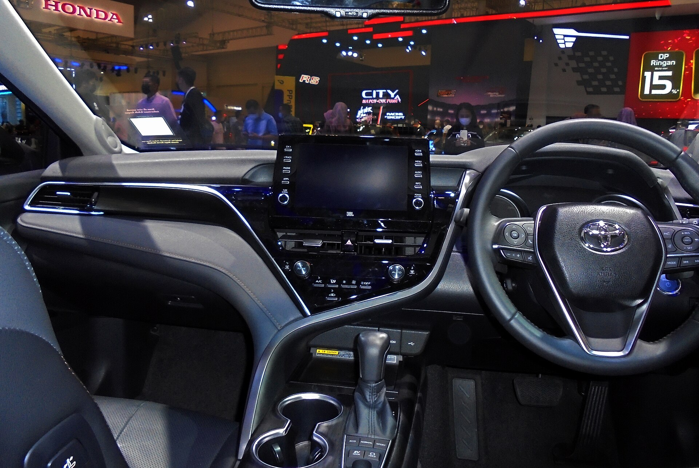

## האם טויוטה קאמרי היברידי עדיין שווה את זה?

בעידן שבו כל יצרן דוחף קרוסאובר חדש כל רבעון, **טויוטה קאמרי היברידי** מזכירה לנו למה סדאן גדול עדיין יכול להיות הבחירה החכמה. זהו רכב משפחתי מרווח, שקט במיוחד וחסכן להפליא, שמציע נוחות נסיעה שקרוסאוברים רבים פשוט לא מתקרבים אליה. אם אתם מחפשים רכב אמין לשנים רבות, עם צריכת דלק נמוכה וערך שייר יציב — הקאמרי נשארת שחקנית רלוונטית מאוד בשוק הישראלי.

## מערכת ההנעה: חשמל ובנזין בהרמוניה

בלב הקאמרי ההיברידי פועלת מערכת ההנעה המוכרת של טויוטה, המשלבת מנוע בנזין בנפח 2.5 ליטר עם מנוע חשמלי וסוללה. ההספק המשולב עומד על כ-**218 כוחות סוס**, מספיק בהחלט כדי להניע את הסדאן בביטחון, בין אם בעיר ובין אם בכביש מהיר.

התחושה מאחורי ההגה רגועה ולינארית. בנסיעה עירונית הרכב נע לא פעם על חשמל בלבד, בשקט מוחלט, והמעבר בין המנועים כמעט בלתי מורגש. גם אם זו לא מכונית ספורט, התאוצה חלקה ומספקת לכל תרחיש יומיומי.

### כמה דלק היא באמת צורכת?

כאן הקאמרי זורחת. בנהיגה מעורבת קל להגיע לצריכה ממוצעת של כ-**4.5 עד 5 ליטר ל-100 ק"מ**, ובנהיגה עירונית רגועה אפשר אף לרדת מכך. עבור רכב בגודל הזה מדובר בנתון מרשים, שחוסך אלפי שקלים בשנה בהוצאות הדלק לעומת סדאן בנזין רגיל.

## נוחות ומרחב פנים

תא הנוסעים של הקאמרי משדר יוקרה שקטה. החומרים נעימים למגע, ההרכבה מוקפדת, ובגרסאות הגבוהות מקבלים ריפודי עור, מערכת מולטימדיה עם מסך מרכזי, טעינה אלחוטית וחיישני חניה. **המרחב למושב האחורי נדיב במיוחד**, ומאפשר לשלושה מבוגרים לשבת בנוחות גם בנסיעות ארוכות.

תא המטען גדול ושימושי, ומתאים בקלות למזוודות משפחתיות או לציוד יומיומי. בידוד הרעשים יוצא דופן — רעשי רוח וכביש מסוננים היטב, מה שהופך את חוויית הנסיעה לשלווה ונינוחה.

## בטיחות: מה מקבלים כסטנדרט?

טויוטה מציידת את הקאמרי במערך הבטיחות **Toyota Safety Sense** כבר מגרסת הבסיס. הוא כולל בין היתר:

- בלימת חירום אוטומטית עם זיהוי הולכי רגל
- בקרת שיוט אדפטיבית
- שמירה במרכז הנתיב והתרעת סטייה
- זיהוי תמרורים והתרעת שטח מת

מדובר בחבילה מקיפה שמעניקה שקט נפשי בנהיגה יומיומית ובנסיעות בין-עירוניות.

## טבלת השוואה: קאמרי היברידי מול מתחרים

| פרמטר | טויוטה קאמרי היברידי | יונדאי סונטה היברידי | סקודה אוקטביה |
|---|---|---|---|
| סוג הנעה | היברידי | היברידי | בנזין / היברידי קל |
| הספק משולב (כ') | כ-218 | כ-195 | כ-150 |
| צריכת דלק ממוצעת | כ-4.5-5 ל'/100 ק"מ | כ-5-5.5 ל'/100 ק"מ | כ-6-6.5 ל'/100 ק"מ |
| גודל תא מטען | גדול מאוד | גדול | גדול |
| ערך שייר | גבוה מאוד | בינוני-גבוה | בינוני |

## למי מתאימה הקאמרי?

הקאמרי ההיברידי מתאימה במיוחד למי שעושה הרבה קילומטרים, מעריך שקט ונוחות על פני חדות ספורטיבית, ורוצה רכב שלא יאכזב במשך שנים. היא בחירה מצוינת למשפחות, לאנשי עסקים ולכל מי שמחפש **סדאן היברידי** אמין ללא כאבי ראש.

מנגד, מי שמחפש תחושת גובה של קרוסאובר או עיצוב פורץ דרך, אולי יעדיף אלטרנטיבה אחרת. אך מבחינת ההיגיון הכלכלי והנוחות היומיומית — הקאמרי ממשיכה להוכיח את עצמה.

## שורה תחתונה

טויוטה קאמרי היברידי אינה המרגשת בשוק, אבל היא אחת ההגיוניות שבהן. חיסכון בדלק, אמינות מוכחת, מרחב נדיב ושקט נסיעה יוצא דופן — כל אלה הופכים אותה לרכב שקל מאוד להמליץ עליו. בשוק שרץ אחרי הטרנד הבא, הקאמרי מזכירה שלפעמים הבחירה הבוגרת היא גם הנכונה.
