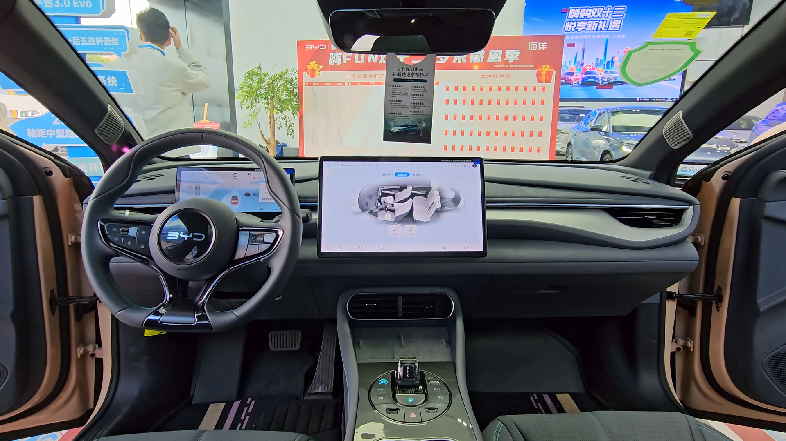

## מה הופך את BYD סיל למעניינת בישראל?

**BYD סיל** היא סדאן חשמלית ספורטיבית שנכנסה לשוק הישראלי כדי לאתגר את טסלה מודל 3 במגרש הביתי שלה. מדובר ברכב חשמלי לחלוטין עם עיצוב אווירודינמי מרשים, טווח נדיב וביצועים שמפתיעים לטובה — והכל במחיר שממצב אותו כבחירה שקולה מאוד לקונה הישראלי שמחפש חשמלית פרימיום בלי לשלם מחיר פרימיום.

BYD, יצרנית הרכב החשמלי הגדולה בעולם, כבר ביססה נוכחות משמעותית בישראל עם דגמים כמו אטו 3 ודולפין. סיל היא הצעד הבא — רכב שמכוון גבוה יותר, גם מבחינת תדמית וגם מבחינת חוויית נהיגה.

## עיצוב: אווירודינמיקה בשירות הטווח

העיצוב של סיל נושא את שפת "אסתטיקה של האוקיינוס" של BYD, עם קווים זורמים, חזית נמוכה וגג משופע. מקדם הגרר הנמוך (סביב 0.22) לא רק נראה טוב — הוא תורם ישירות לטווח וליעילות האנרגטית.

בתוך הרכב מקבלים תא נוסעים מרווח, חומרים איכותיים ומסך מגע מרכזי מסתובב בגודל כ-15 אינץ' שמנהל את רוב הפונקציות. יש גם לוח מחוונים דיגיטלי נפרד מול הנהג — יתרון ברור על פני הגישה המינימליסטית של טסלה.

### נוחות ומרחב

בזכות רצפה שטוחה ובסיס גלגלים ארוך, שלושת הנוסעים מאחור מקבלים מרחב רגליים נדיב. תא המטען מציע נפח סביר, ובחלק מהגרסאות קיים גם תא אחסון קדמי קטן.

## טווח וביצועים: הנתונים שחשובים

**BYD סיל** מגיעה במספר תצורות הנעה. גרסת ההנעה האחורית מתמקדת ביעילות וטווח, בעוד גרסת ההנעה הכפולה (AWD) מדגישה ביצועים — עם האצה של פחות מ-4 שניות מ-0 ל-100 קמ"ש.

כל הגרסאות משתמשות בסוללת **Blade** הייחודית של BYD, המבוססת על כימיית ליתיום-ברזל-פוספט. הסוללה ידועה ביציבות התרמית שלה, בבטיחות גבוהה ובעמידות לאורך זמן — יתרון משמעותי באקלים החם של ישראל.

## טבלת השוואה: BYD סיל מול טסלה מודל 3

| פרמטר | BYD סיל | טסלה מודל 3 |
|---|---|---|
| סוג סוללה | Blade (ליתיום-ברזל-פוספט) | ליתיום-יון / LFP |
| טווח מוערך (WLTP) | כ-520-570 ק"מ | כ-510-560 ק"מ |
| האצה 0-100 (גרסה מהירה) | פחות מ-4 שניות | כ-4-4.4 שניות |
| לוח מחוונים מול נהג | קיים | אין (מסך מרכזי בלבד) |
| רשת טעינה ייעודית | רשתות ציבוריות | סופרצ'רג'ר + ציבורי |
| גישת עיצוב פנים | קלאסית-יוקרתית | מינימליסטית |

## טעינה: כמה זמן ואיך

סיל תומכת בטעינה מהירה בזרם ישר, שמאפשרת מילוי משמעותי של הסוללה בפרק זמן קצר בעמדות ציבוריות מהירות. בבית, עם עמדת טעינה בזרם חילופין, ניתן לטעון את הרכב במלואו במהלך הלילה — פתרון אידיאלי לרוב הנהגים הישראלים שנוסעים עשרות ק"מ ביום.

חשוב לזכור: טווח הנהיגה בפועל מושפע מסגנון הנהיגה, מהירות, שימוש במיזוג ותנאי הדרך. בנהיגה עירונית מתונה קל יחסית להתקרב לנתוני היצרן, בעוד נהיגה מהירה בכביש בין-עירוני תוריד מהטווח.

## בטיחות ומערכות סיוע

BYD סיל מגיעה עם חבילה עשירה של מערכות סיוע לנהג, הכוללת בקרת שיוט אדפטיבית, שמירת נתיב, זיהוי הולכי רגל ובלימת חירום אוטומטית. הרכב זכה לדירוגי בטיחות גבוהים במבחני התרסקות אירופיים, מה שמחזק את מעמדו כאופציה משפחתית בטוחה.

## למי מתאימה BYD סיל?

הסדאן החשמלית הזו מתאימה במיוחד למי שמחפש:

- **חשמלית ספורטיבית** עם ביצועים חזקים ועיצוב מרשים
- **טווח נדיב** לנסיעות ארוכות בלי חרדת טווח
- **תא פנים עשיר** בחומרים ובטכנולוגיה, כולל לוח מחוונים נפרד
- **אלטרנטיבה לטסלה** במחיר תחרותי ועם אחריות יצרן

מי שמעדיף את רשת הסופרצ'רג'ר של טסלה או את הפשטות של הממשק שלה — אולי ימצא את מודל 3 מתאימה יותר. אבל מבחינת תמורה לכסף, BYD סיל היא יריבה אמיתית שראויה לבדיקה רצינית.

## שורה תחתונה

**BYD סיל** מוכיחה שהיצרניות הסיניות כבר לא רק מתחרות במחיר — הן מתחרות באיכות, בביצועים ובחוויית נהיגה. עם סוללת Blade הבטוחה, עיצוב מוקפד וטווח מכובד, סיל היא אחת מההצעות החשמליות המעניינות ביותר שהגיעו לישראל בשנים האחרונות.
