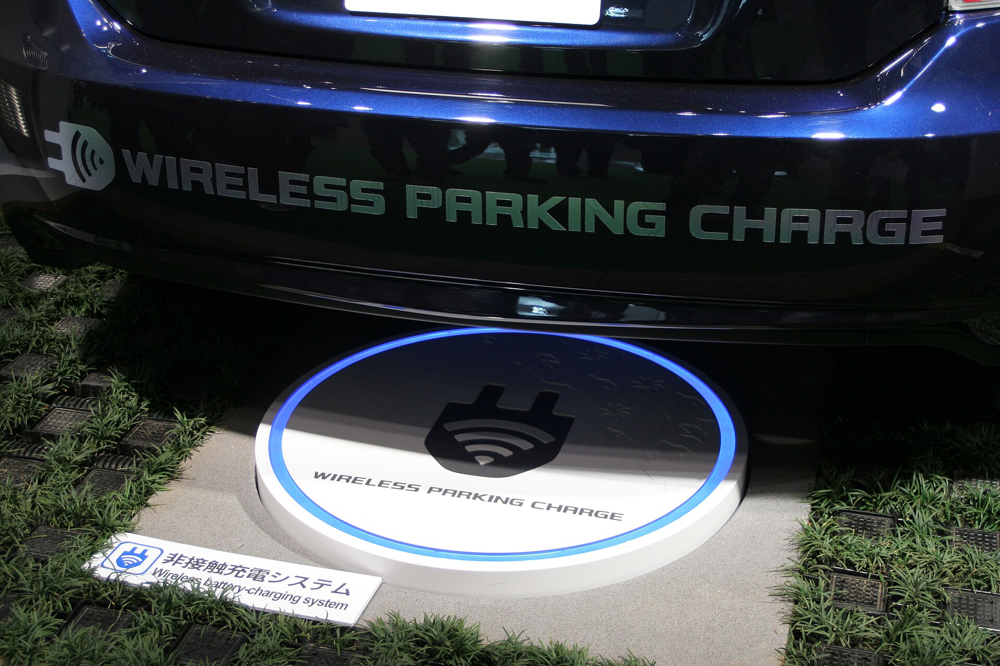

## מה הן סוללות מצב מוצק ולמה כולם מדברים עליהן?

**סוללות מצב מוצק** (Solid-State) נחשבות כיום לפריצת הדרך הגדולה ביותר בעולם הרכב החשמלי. בניגוד לסוללות ליתיום-יון הנפוצות היום, שמשתמשות באלקטרוליט נוזלי להעברת היונים בין הקטבים, בסוללות מצב מוצק האלקטרוליט הוא חומר מוצק. השינוי הזה, שנשמע טכני וקטן, עשוי לשנות לחלוטין את חוויית השימוש ברכב חשמלי: טווח ארוך יותר, טעינה מהירה בהרבה ובטיחות גבוהה יותר.

עבור הנהג הישראלי, שמתלבט בין רכב חשמלי להיברידי בעיקר בגלל חרדת טווח וזמני טעינה, **סוללות מצב מוצק** הן בדיוק התשובה שהתעשייה מחפשת.

## מה היתרונות המרכזיים?

המעבר לאלקטרוליט מוצק מביא איתו כמה יתרונות משמעותיים:

- **צפיפות אנרגיה גבוהה יותר** — יותר אנרגיה באותו נפח ומשקל, כלומר טווח ארוך יותר ללא הגדלת הסוללה.
- **טעינה מהירה** — יצרניות מדווחות על יעד של טעינה מ-10 ל-80 אחוז בתוך דקות בודדות.
- **בטיחות משופרת** — אלקטרוליט מוצק אינו דליק כמו נוזלי, ולכן הסיכון להתלקחות או ל"בריחה תרמית" קטן משמעותית.
- **אורך חיים ארוך יותר** — פחות בלאי כימי לאורך זמן, מה שעשוי לשמור על בריאות הסוללה לאורך שנים רבות.
- **ביצועים בקור** — פוטנציאל לרגישות נמוכה יותר לטמפרטורות נמוכות, יתרון בחורף הישראלי ובאזורי הצפון.

## כמה טווח זה באמת מוסיף?

ההבטחות של היצרניות שאפתניות. טויוטה, למשל, הציגה יעד של טווח שעשוי להגיע עד כ-1,000 ק"מ בטעינה אחת בדגמים מסוימים, וזמן טעינה של כ-10 דקות בלבד. חשוב לזכור שאלו יעדים מהמעבדה, והמספרים בפועל יהיו נמוכים יותר בתנאי כביש אמיתיים — אבל גם קפיצה חלקית תהפוך את חרדת הטווח לנחלת העבר.

## מי מובילה את המרוץ?

כמעט כל יצרנית גדולה משקיעה בטכנולוגיה, אך חלקן מתקדמות יותר:

| יצרנית | סטטוס פיתוח | יעד ייצור מוערך |
|---|---|---|
| טויוטה | מתקדמת, שיתוף פעולה עם אידמיטסו | סביב 2027-2028 |
| ניסאן | קו ייצור פיילוט פעיל | סוף העשור |
| סמסונג אס.די.איי | דגימות ללקוחות | 2027 ואילך |
| מרצדס-בנץ | ניסויי כביש עם שותפה טכנולוגית | סוף העשור |
| בי.ואם.דאבליו | פיתוח מתמשך | לא סופי |

הנתונים בטבלה הם הערכות המבוססות על הכרזות היצרניות, ולוחות הזמנים עשויים להשתנות.

## מתי זה יגיע לישראל?

גם כאשר הייצור המסחרי יתחיל, הטכנולוגיה לא תגיע לכולם בבת אחת. בשלב הראשון המחיר הגבוה של הסוללות החדשות יכתיב שילוב שלהן **בדגמי יוקרה וספורט** — מותגים כמו לקסוס, מרצדס או בי.אם.דאבליו. רק בהמשך, ככל שהייצור יתרחב והעלויות ירדו, הטכנולוגיה תחלחל לדגמים המשפחתיים הנגישים יותר כמו טויוטה, יונדאי וקיה.

עבור השוק הישראלי, שבו מיסוי הרכב החשמלי משתנה ומחירי הרכבים רגישים מאוד, סביר שהדגמים הראשונים עם **סוללות מצב מוצק** יגיעו כמה שנים אחרי ההשקה העולמית. בינתיים, סוללות הליתיום-יון ממשיכות להשתפר, וגם סוללות ליתיום-ברזל-פוספט (LFP) הזולות יותר תופסות נתח גובר בשוק.

## אז כדאי לחכות?

זו השאלה המרכזית של כל מי ששוקל רכב חשמלי כעת. התשובה הקצרה: **לא בהכרח.** הרכבים החשמליים של היום כבר מספקים טווח של 400-500 ק"מ ברוב הדגמים, ורשת הטעינה בישראל מתרחבת בקצב מהיר. סוללות מצב מוצק הן אבן דרך מרגשת, אבל הן עדיין רחוקות כמה שנים מהשוק ההמוני, והדורות הראשונים יהיו יקרים.

מי שזקוק לרכב עכשיו ייהנה מטכנולוגיה בוגרת ואמינה. מי שיכול להמתין — ייתכן שימצא בעוד כמה שנים שוק חשמלי שונה לחלוטין, עם טווחים שיתחרו ישירות ברכבי הבנזין.
