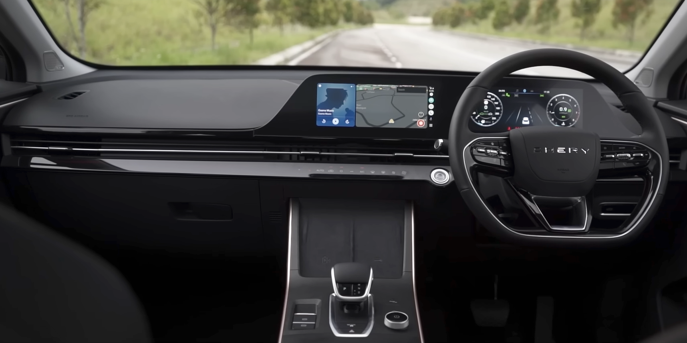

## אומודה 5 — מה היא בעצם?

**אומודה 5** היא קרוסאובר קומפקטי מבית המותג אומודה, שהוא זרוע עצמאית של ענקית הרכב הסינית צ'רי. בישראל היא מגיעה עם מנוע בנזין טורבו ותיבה אוטומטית, ומציבה לעצמה מטרה ברורה: להציע חבילה עשירה של אבזור, עיצוב וטכנולוגיה במחיר נמוך מזה של המתחרים המסורתיים. אחרי שבוע של נהיגה, התשובה הקצרה היא שאומודה 5 אכן מפתיעה לטובה — אך עם כמה הסתייגויות שחשוב להכיר.

## עיצוב חיצוני שמושך מבטים

הדבר הראשון שבולט באומודה 5 הוא השפה העיצובית הנועזת. הגריל הקדמי הגדול, פנסי הלד הדקים והקווים החדים לאורך הדפנות נותנים לה נוכחות של רכב יקר יותר. בצד האחורי בולטת רצועת פנסים רוחבית אופנתית. מדובר ברכב שמצליח להיראות עכשווי וצעיר, בדיוק לטעם הקהל שמחפש משהו שונה מהקרוסאוברים ה"בטוחים" של היצרנים היפנים.

## תא הנוסעים: מרשים ביחס למחיר

כאן אומודה 5 עושה את העבודה הטובה ביותר שלה. עם הכניסה מקבלים שני מסכים גדולים המחוברים לכדי יחידה אחת — לוח מחוונים דיגיטלי ומסך מולטימדיה מרכזי — שנותנים תחושה טכנולוגית ומודרנית. חומרי הגימור רכים למגע באזורים המרכזיים, והעיצוב הפנימי נקי ומינימליסטי.

מבחינת מרווחים, הקרוסאובר מציע ישיבה נוחה מלפנים ומקום סביר מאחור לשני מבוגרים. תא המטען בקיבולת בינונית, מספיק לצרכים משפחתיים יומיומיים אך לא יוצא דופן לקטגוריה.

### מערכת המולטימדיה

המסך המרכזי גדול וחד, אך הממשק דורש התרגלות וחלק מהפונקציות הבסיסיות (כמו כוונון המזגן) מוסתרות בתפריטים. חיבור אלחוטי לטלפון קיים, והתגובתיות סבירה. זהו תחום שבו היצרנים הסיניים עדיין משתפרים מדור לדור.

## איך היא נוהגת?

תחת מכסה המנוע פועל מנוע בנזין טורבו קטן המספק ביצועים סבירים לנהיגה עירונית ובינעירונית. בתנועה רגילה אומודה 5 שקטה ונוחה, אך בלחיצת גז חזקה מורגש מעט היסוס מצד תיבת ההילוכים הרציפה. 

כיוון המתלים נוטה לצד הנוקשה, מה שתורם ליציבות בפניות אך מורגש בכבישים משובשים — תחום שמאוד רלוונטי לכבישים הישראליים. ההגה קל ומדויק דיו לנהיגה עירונית נינוחה. בכל הנוגע לצריכת דלק, מדובר בטווח בינוני עד גבוה יחסית למתחרים ההיברידיים, ולכן מי שמחפש חסכוניות מקסימלית כדאי שיביא זאת בחשבון.

## טבלת השוואה: אומודה 5 מול המתחרות

| פרמטר | אומודה 5 | טויוטה קורולה קרוס | קיה סלטוס |
|---|---|---|---|
| סוג הנעה | בנזין טורבו | היברידי | בנזין |
| רמת אבזור | גבוהה מאוד | בינונית-גבוהה | גבוהה |
| נוחות מתלים | נוקשה מעט | נוחה | מאוזנת |
| חסכוניות | בינונית | מצוינת | טובה |
| מיצוב מחיר | תחרותי מאוד | גבוה יותר | בינוני |

## בטיחות ואחריות

אומודה 5 מגיעה עם חבילת מערכות בטיחות אקטיביות מלאה, הכוללת בלימת חירום אוטומטית, בקרת סטייה מנתיב ובקרת שיוט אדפטיבית. זהו יתרון משמעותי במחיר שבו היא מוצעת. כמו אצל יצרנים סיניים אחרים, חבילת האחריות הנדיבה היא נקודת מכירה מרכזית, ומפחיתה מהחשש של קונים שחוששים ממותג חדש יחסית.

## למי אומודה 5 מתאימה?

אם אתם מחפשים קרוסאובר קומפקטי עם עיצוב בולט, תא נוסעים עשיר וטכנולוגי ומחיר שובר שוק — **אומודה 5** היא מועמדת רצינית. היא פחות מתאימה למי שמחפש חסכוניות היברידית מקסימלית או נוחות נסיעה רכה במיוחד. בשורה התחתונה, זהו רכב שמוכיח עד כמה היצרנים הסיניים התקדמו, ומציב אתגר אמיתי לשחקנים הוותיקים בשוק הישראלי.
