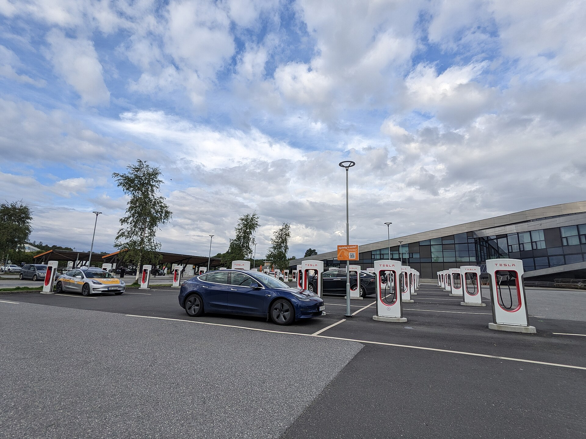

טסלה מודל Y ג'וניפר היא הגרסה המחודשת של הקרוסאובר החשמלי הנמכר בעולם, והיא מגיעה לישראל עם שדרוג מקיף של העיצוב, הנוחות והטכנולוגיה. מדובר באותו רכב מוכר ואהוב, אך עם ליטוש משמעותי שהופך אותו לרלוונטי ותחרותי יותר בשוק החשמליות הגועש של 2026. אם שקלתם קרוסאובר חשמלי משפחתי, **טסלה מודל Y** החדשה חייבת להיות ברשימה שלכם.

## מה השתנה בטסלה מודל Y ג'וניפר?

השדרוג המרכזי הוא חיצוני: חזית חדשה עם רצועת תאורה מלאה לרוחב, פנסים דקים יותר ועיצוב אווירודינמי משופר. גם החלק האחורי קיבל רצועת תאורה רציפה שמעניקה לרכב נוכחות מודרנית יותר. השינויים אינם רק אסתטיים — הם תורמים להפחתת גרר האוויר, ובכך לשיפור הטווח והיעילות.

בתוך הקבינה, טסלה השקיעה בעיקר בשני תחומים: שקט נסיעה ואיכות חומרים. זגוגיות כפולות, בידוד אקוסטי משופר ומתלים מכוילים מחדש הופכים את הנסיעה לרגועה ושקטה בהרבה מהדור הקודם, שנחשב מעט רועש וקשיח.

### עיצוב פנים וטכנולוגיה

המסך המרכזי בגודל 15.4 אינץ' נותר לב המערכת, ושולט כמעט על כל פונקציות הרכב. בגרסה המחודשת נוסף מסך אחורי קטן לנוסעים במושב השני, לשליטה במיזוג ובמולטימדיה. המושבים מאווררים, החומרים משודרגים, ותאורת הסביבה מקיפה את כל הקבינה. מערכת ההפעלה של טסלה נותרה מהמהירות והחלקות בשוק, עם עדכוני תוכנה אלחוטיים תכופים.

## מהו הטווח של טסלה מודל Y החדשה?

הטווח תלוי בגרסה ובגודל הסוללה. הגרסאות הבסיסיות מציעות טווח מוצהר של סביב 450–500 ק"מ, בעוד הגרסאות ארוכות-הטווח (Long Range) מתקרבות לכ-600 ק"מ במחזור הבדיקה האירופי. בפועל, בנהיגה ישראלית מעורבת בקיץ, סביר לצפות לצריכה ריאלית נמוכה מהמוצהר — אך עדיין בטווח נוח לרוב הנהגים.

יתרון בולט הוא רשת **העל-טעינה (Supercharger)** של טסלה, שממשיכה להתרחב בישראל ומאפשרת טעינה מהירה וזמינה בנסיעות ארוכות. זהו אולי היתרון המשמעותי ביותר של טסלה על פני מתחרות, במיוחד לנוסעים בין ערים.

## השוואה: טסלה מודל Y מול מתחרות

כדי להבין היכן ניצבת טסלה מודל Y ג'וניפר בשוק, הנה השוואה כללית מול שתי מתחרות מרכזיות בקטגוריית הקרוסאוברים החשמליים המשפחתיים:

| פרמטר | טסלה מודל Y ג'וניפר | סקודה אניאק | קיה EV6 |
|---|---|---|---|
| קטגוריה | קרוסאובר חשמלי בינוני | קרוסאובר חשמלי בינוני | קרוסאובר חשמלי בינוני |
| טווח מוצהר (לפי גרסה) | כ-450–600 ק"מ | כ-430–560 ק"מ | כ-430–530 ק"מ |
| רשת טעינה ייעודית | כן (Supercharger) | לא | לא |
| מערכת מולטימדיה | מסך מרכזי גדול, עדכונים אלחוטיים | ממשק סטנדרטי | ממשק כפול-מסך |
| אופי כללי | טכנולוגי ויעיל | מרווח ופרקטי | ספורטיבי ומעוצב |

הטבלה היא כללית ונועדה להמחשה; הנתונים המדויקים משתנים לפי גרסה, שנתון ומחזור בדיקה.

## כמה תעלה טסלה מודל Y בישראל?

התמחור בישראל מושפע מאוד ממדיניות המיסוי על רכבים חשמליים, שעוברת שינויים הדרגתיים בשנים הקרובות. מחיר ההשקה צפוי להתחיל בטווח של מאות אלפי שקלים, כאשר הגרסאות ארוכות-הטווח והביצועיות יקרות יותר. חשוב לעקוב אחר עליית מס הקנייה על חשמליות, שעשויה להשפיע על המחיר הסופי לצרכן.

### למי מתאימה טסלה מודל Y ג'וניפר?

הרכב מתאים במיוחד למשפחות שמחפשות קרוסאובר חשמלי מרווח, יעיל ועתיר טכנולוגיה, ולמי שמעריך את הנוחות של רשת טעינה ייעודית. מי שמחפש חוויית נהיגה אנלוגית יותר או ריבוי כפתורים פיזיים עשוי להתקשות עם הגישה המסכית של טסלה — אך רוב המשתמשים מתרגלים אליה במהירות.

## שורה תחתונה

טסלה מודל Y ג'וניפר לוקחת נוסחה מנצחת ומשפרת אותה בנקודות הנכונות: שקט, נוחות, עיצוב וטווח. בשילוב עם רשת העל-טעינה והעדכונים האלחוטיים, היא נותרת אחת הבחירות ההגיוניות ביותר בקטגוריית הקרוסאוברים החשמליים בישראל — בכפוף למחיר הסופי שייקבע לאחר המיסוי.
