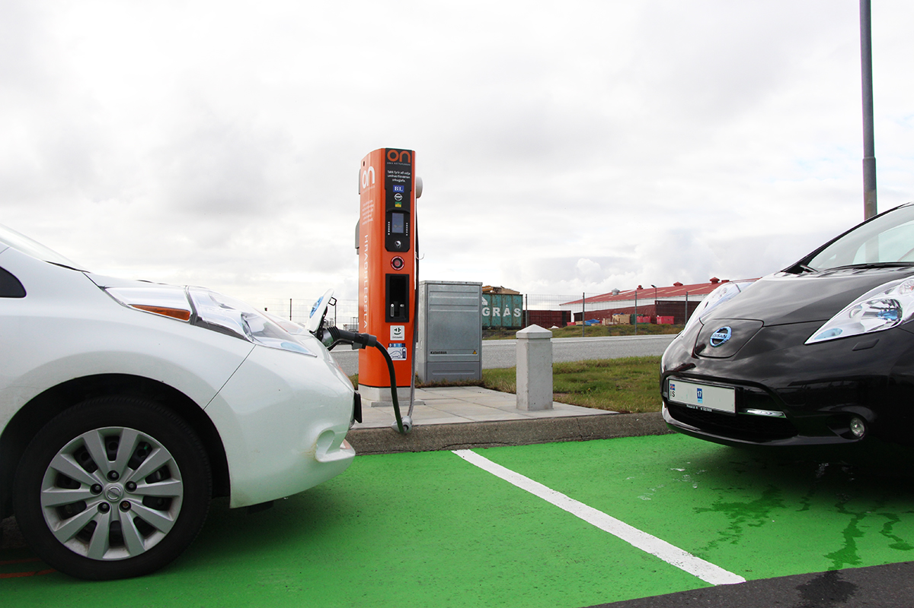

## מה חדש: אקספנג G6 מגיעה לישראל

אקספנג G6 מצטרפת לגל הרכבים החשמליים הסיניים שמשנים את מפת השוק הישראלי, והיא מגיעה עם יומרה ברורה: להתמודד פנים אל פנים מול טסלה מודל Y. מדובר בקרוסאובר חשמלי בגודל בינוני, עם עיצוב אווירודינמי נקי, טווח נסיעה גדול ויכולת טעינה מהירה שמציבה אותה בחזית הטכנולוגית. היצרן הסיני, שכבר נחשב לאחד השמות המדוברים בתחום הרכב החשמלי, מכוון עם ה-G6 אל לב השוק המשפחתי המתעניין בחשמל.

## למי מיועדת אקספנג G6?

ה-G6 פונה למשפחה הישראלית שמחפשת רכב חשמלי יומיומי אחד שיעשה הכול: נסיעות עירוניות, הסעות ילדים ונסיעות ארוכות בין-עירוניות ללא חרדת טווח. הממדים שלה ממקמים אותה בדיוק בקטגוריה החמה ביותר בישראל — קרוסאוברים בגודל בינוני — לצד שמות כמו טסלה מודל Y, סקודה אניאק וקיה EV6.

תא הנוסעים מרווח, עם מרחק סבבים נדיב במושב האחורי ותא מטען בנפח שאמור להספיק בקלות לצרכים משפחתיים. בתוך הקבינה בולט מסך מגע מרכזי גדול שמרכז את מרבית הפונקציות, לצד צג דיגיטלי מול הנהג ואבזור נוחות עשיר שכבר הפך לסטנדרט ברכבים הסיניים החדשים.

## טווח וטעינה: היתרון הטכנולוגי

אחד מקלפי המיקוח המרכזיים של אקספנג G6 הוא הטווח. בהתאם לגרסה ולקיבולת הסוללה, הטווח המוצהר נע בטווח רחב של כ-550 עד 750 קילומטרים במחזורי בדיקה אירופיים — נתון שבפועל יתורגם לטווח שימושי נוח גם בתנאי מזג האוויר הישראלי.

היתרון הבולט נוסף הוא **ארכיטקטורת 800 וולט**, שעדיין נדירה יחסית במחירים האלה. משמעותה טעינה מהירה במיוחד: בעמדות טעינה מהירות מתאימות, מילוי הסוללה מרמה נמוכה לרמה גבוהה יכול להתבצע בפרק זמן קצר של דקות ספורות בלבד, מה שמקרב את חוויית ההמתנה לזו של תדלוק רכב דלק.

## אקספנג G6 מול המתחרות

כדי להבין את מיקומה של אקספנג G6 בשוק הישראלי, שווה להשוות אותה למתחרות הבולטות בקטגוריה:

| פרמטר | אקספנג G6 | טסלה מודל Y | קיה EV6 |
|---|---|---|---|
| סוג | קרוסאובר חשמלי בינוני | קרוסאובר חשמלי בינוני | קרוסאובר חשמלי בינוני |
| טווח מוצהר (משוער) | כ-550–750 ק"מ | כ-450–600 ק"מ | כ-500–700 ק"מ |
| ארכיטקטורה | 800 וולט | 400 וולט | 800 וולט |
| מסך מרכזי | גדול | גדול | גדול |
| דגש עיקרי | ערך מול תמורה | רשת טעינה ותוכנה | עיצוב וביצועים |

הטבלה ממחישה היטב את האסטרטגיה של אקספנג: להציע מפרט טכנולוגי מתקדם, ובראשו ארכיטקטורת 800 וולט וטווח גדול, במחיר שאמור להיות תחרותי מול השמות המבוססים.

## כמה היא תעלה בישראל?

המחיר הוא כמובן הגורם המכריע, במיוחד לאור העלייה המתוכננת במיסוי על רכבים חשמליים. נכון לרגע זה מדובר בהערכות בלבד, אך על פי מיצובה של אקספנג מול המתחרים הישירים, סביר שהיא תמוקם ככלי שמציע **ערך גבוה מול תמורה** — כלומר מפרט עשיר יחסית למחיר. הקונה הישראלי ששוקל רכב חשמלי משפחתי יצטרך להשוות לא רק את תג המחיר אלא גם את עלות הטעינה החודשית, האחריות על הסוללה ופריסת נקודות השירות.

חשוב לזכור כי המיסוי על רכבים חשמליים בישראל ממשיך לעלות בהדרגה, ולכן תזמון הרכישה והמחיר הסופי שייקבע על ידי היבואן ישפיעו ישירות על האטרקטיביות של העסקה.

## שורה תחתונה

אקספנג G6 מצטרפת לרשימה ההולכת ומתארכת של רכבים חשמליים סיניים שמציעים מפרט מרשים במחיר תחרותי. עם טווח נדיב, ארכיטקטורת 800 וולט לטעינה מהירה ותא נוסעים משפחתי, היא מהווה אלטרנטיבה ראויה לבחינה לצד טסלה מודל Y והמתחרות הקוריאניות. כמו בכל כניסה של מותג חדש לשוק, מבחן האמת יהיה בשירות, בחלפים ובערך השייר לאורך זמן — ואלה יתבררו רק עם הזמן.
