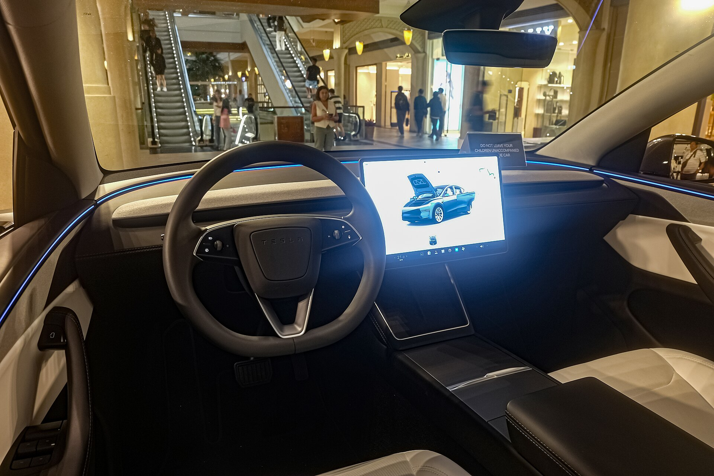

טסלה Model Y ג'וניפר היא הגרסה המחודשת של הקרוסאובר החשמלי הנמכר בעולם, והיא בדרכה לישראל עם שלל שיפורים בעיצוב, בנוחות ובשקט הנסיעה. מדובר בעדכון מקיף שנועד לשמר את הבכורה של הדגם מול תחרות גוברת, במיוחד מצד היצרניות הסיניות שכבשו נתח משמעותי מהשוק המקומי.

הכינוי "ג'וניפר" (Juniper) הוא שם הקוד הפנימי של טסלה לעדכון, בדומה לשם "היילנד" (Highland) שליווה את חידוש ה-Model 3. מי שהתרשם מהשינויים ב-Model 3 המחודש יזהה כאן גישה דומה: שיפור של מוצר מצליח בלי לשבור אותו מחדש.

## מה חדש בטסלה Model Y ג'וניפר?

השינוי הבולט ביותר הוא בחזית וברכב האחורי. מלפנים הותקנה רצועת תאורה חדשה המשתרעת לרוחב, בדומה למגמה שרואים אצל יצרניות פרימיום רבות. מאחור, פס אור אדום רציף משדרג את המראה והופך את הרכב למובחן יותר בכביש. הפרופיל האווירודינמי עודכן אף הוא, מה שתורם ליעילות האנרגטית וגם לשקט בנסיעה.

בתוך תא הנוסעים הושקע מאמץ רב בהורדת רמת הרעש. טסלה הוסיפה זיגוג כפול בחלונות, שיפרה את הבידוד האקוסטי ועדכנה את החומרים הפנימיים. התוצאה היא חוויית נהיגה שקטה ומפנקת יותר, פער מורגש לעומת הדור הקודם שנחשב לרועש יחסית במהירויות גבוהות.

### מערכת המולטימדיה והנוחות

המסך המרכזי נותר אבן היסוד של חווית המשתמש, והוא מהיר וחד כתמיד. נוספה גם תצוגה אחורית לנוסעים במושב השני, בדומה לזו שהוצגה ב-Model 3 המחודש. מערכת ההגה והבקרות עודכנה, והישיבה מאחור שודרגה מבחינת זווית ונוחות.

## נתונים טכניים עיקריים

טסלה צפויה להציע את הדגם במספר תצורות הנעה: גרסת הנעה אחורית בעלת טווח גבוה, וגרסת הנעה כפולה (ארבע גלגלים) חזקה ומהירה יותר. הטווח המדווח בתקן אירופי צפוי לנוע בטווח רחב בהתאם לתצורה ולגודל הסוללה, עם שיפור קל לעומת הדור היוצא הודות ליעילות המשופרת.

| מאפיין | Model Y דור קודם | Model Y ג'וניפר |
|---|---|---|
| עיצוב חזית | פנסים נפרדים | רצועת תאורה רציפה |
| שקט בתא | בינוני | משופר משמעותית |
| זיגוג | רגיל | כפול בחלקים מהחלונות |
| מסך אחורי | אין | קיים לנוסעים |
| אווירודינמיקה | טובה | משופרת |

*הנתונים בטבלה הם כלליים ונועדו להמחשה; המפרט הסופי לישראל עשוי להשתנות.*

## כמה זה יעלה בישראל?

התמחור המדויק תלוי בתצורה, בגודל הסוללה ובמדיניות המיסוי על רכבים חשמליים, שצפויה להתעדכן בשנים הקרובות. ככלל, המחיר צפוי לנוע סביב טווח המחירים של הדגם היוצא, עם אפשרות להתאמות בהתאם לעליית מס הקנייה המתוכננת על רכבים חשמליים. מומלץ לעקוב אחר הכרזות היבואן הרשמי לקבלת מחירון מעודכן.

## למי הדגם מתאים?

טסלה Model Y ג'וניפר מתאימה למשפחות ולנהגים המחפשים קרוסאובר חשמלי מרווח, עם רשת טעינה מהירה פרושה (Superchargers) ועם חווית תוכנה מהמתקדמות בשוק. השיפורים בשקט ובנוחות הופכים אותה לרלוונטית יותר מתמיד, בעיקר מול התחרות העזה של דגמים חשמליים חדשים המגיעים לישראל חדשות לבקרים.

מי שכבר שקל את הדגם בעבר אך נרתע מהרעש או מהעיצוב — ימצא כאן גרסה מלוטשת ובוגרת יותר. מנגד, השלד הטכני נותר דומה, כך שאין כאן מהפכה אלא אבולוציה מחושבת.

## שורה תחתונה

טסלה Model Y ג'וניפר היא עדכון חכם שמחזק את אחד הדגמים החשמליים המצליחים בעולם. עם עיצוב מרענן, תא שקט ונוח יותר ושיפורים ביעילות — היא ממצבת את עצמה כבחירה מובילה בקטגוריית הקרוסאוברים החשמליים בישראל. השאלה המרכזית שתכריע את הצלחתה המקומית תהיה, כמו תמיד, המחיר הסופי מול התחרות המתגברת.
