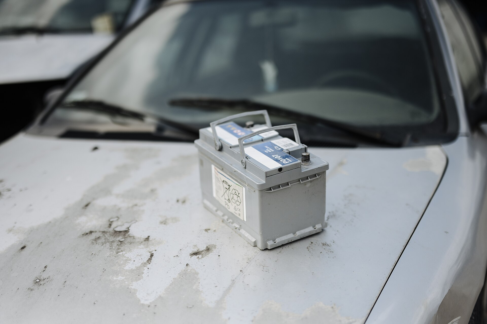

מצבר הרכב הוא הלב החשמלי של כל מכונית — הוא זה שמניע את המנוע בבוקר ומזין את כל המערכות החשמליות. בישראל, שבה הקיץ ארוך וחם, **מצבר הרכב מתכלה מהר יותר מהממוצע העולמי**, ולכן חשוב להכיר את סימני האזהרה לפני שתמצאו את עצמכם תקועים בחניון עם רכב שלא מתניע. במדריך הזה נסביר איך מזהים מצבר גוסס, מה מקצר את חייו, ואיך אפשר להאריך אותם בכמה צעדים פשוטים.

## כמה זמן מחזיק מצבר הרכב?

מצבר עופרת-חומצה סטנדרטי מחזיק בממוצע **3 עד 5 שנים**, אך בתנאי האקלים הישראלי הטווח המציאותי נוטה לקצה הנמוך. החום הקיצוני מאיץ את התאיידות הנוזל והבלאי הפנימי של התאים, בעוד שחילופי העונות החדים מכבידים על יכולת הטעינה. ברכבים עם מערכת Start-Stop משתמשים במצברים מתקדמים מסוג AGM, שעמידים יותר אך גם יקרים יותר להחלפה.

## מהם סימני האזהרה שמצבר הרכב נחלש?

הבעיה עם מצבר היא שהוא לרוב נותן רמזים לפני שהוא נכנע לגמרי. שימו לב במיוחד ל:

- **התנעה איטית וכבדה** — המנוע "מתאמץ" להתניע, במיוחד בבוקר קר.
- **אורות עמומים** — פנסים ותאורת לוח מחוונים שנחלשים בסרק ומתחזקים בהאצה.
- **נורת מצבר דולקת** — סימן לבעיה במעגל הטעינה (מצבר או אלטרנטור).
- **קליק חוזר** — כשמסובבים את המפתח ונשמע תקתוק במקום התנעה.
- **מערכות חשמל קופצות** — מולטימדיה שמתאפסת, חלונות חשמליים איטיים.
- **מצבר נפוח או מריח** — דפורמציה בגוף המצבר או ריח של גופרית הם סימן להחלפה מיידית.

אם זיהיתם שניים או יותר מהסימנים האלה, כדאי לגשת לבדיקה עוד לפני שהמצבר יבגוד בכם לגמרי.

## למה מצברים מתים מוקדם בישראל?

יש כמה גורמים מצטברים שמקצרים את חיי המצבר אצלנו:

1. **חום** — הגורם מספר אחת. טמפרטורות גבוהות מאיצות בלאי כימי.
2. **נסיעות קצרות** — נסיעה של כמה דקות לא מספיקה כדי שהאלטרנטור יטעין את המצבר במלואו.
3. **צריכת חשמל בסרק** — מערכות מולטימדיה, מצלמות, מטענים ואביזרים שמנקזים חשמל גם ברכב כבוי.
4. **חיבורים מחומצנים** — קורוזיה על הקטבים מגדילה התנגדות ופוגעת בטעינה.

## השוואה: מתי מחליפים ומתי מספיק לטעון?

| מצב | סימנים | הפעולה המומלצת |
|------|---------|----------------|
| מצבר חלש זמנית | התרוקן אחרי שהרכב עמד הרבה | טעינה חיצונית או נסיעה ארוכה |
| מצבר בן 4-5 שנים | התנעות איטיות חוזרות | החלפה יזומה |
| נורת מצבר דולקת בנסיעה | אורות מהבהבים | בדיקת אלטרנטור במוסך |
| מצבר נפוח/דולף | עיוות, ריח | החלפה מיידית |

## איך מאריכים את חיי מצבר הרכב?

כמה הרגלים פשוטים יכולים להוסיף לו חודשים ואף שנים:

- **נהגו לפעמים נסיעה ארוכה יותר** (20-30 דקות) כדי לאפשר טעינה מלאה.
- **כבו צרכנים לפני כיבוי המנוע** — מזגן, אורות ומערכת שמע.
- **נקו את הקטבים** מחלודה וקורוזיה והקפידו שהחיבורים הדוקים.
- **אם הרכב עומד ימים רבים** — השתמשו במטען תחזוקה (Trickle Charger) או התניעו אחת לכמה ימים.
- **בדיקה לפני החורף** — רוב המוסכים ותחנות השירות בודקים מצבר בחינם או בעלות סמלית.

## מה עושים כשהמצבר כבר מת?

אם הרכב לא מתניע ואתם בטוחים שזה המצבר, אפשר **להתניע עם כבלים** מרכב אחר: חברו אדום לפלוס של שני הרכבים, שחור לפלוס המינוס ברכב התקין ולנקודת הארקה מתכתית ברכב התקוע. לאחר התנעה מוצלחת, סעו לפחות 20 דקות רצופות. שימו לב — התנעה בכבלים היא פתרון זמני בלבד; מצבר שהתרוקן לחלוטין כנראה כבר קרוב לסוף דרכו ומומלץ לבדוק אותו.

בשורה התחתונה, מצבר הרכב הוא רכיב מתכלה שאי אפשר להתעלם ממנו. **תשומת לב לסימנים המוקדמים ובדיקה תקופתית** יחסכו לכם את התרחיש המתסכל של רכב שלא מתניע בדיוק כשאתם ממהרים.
