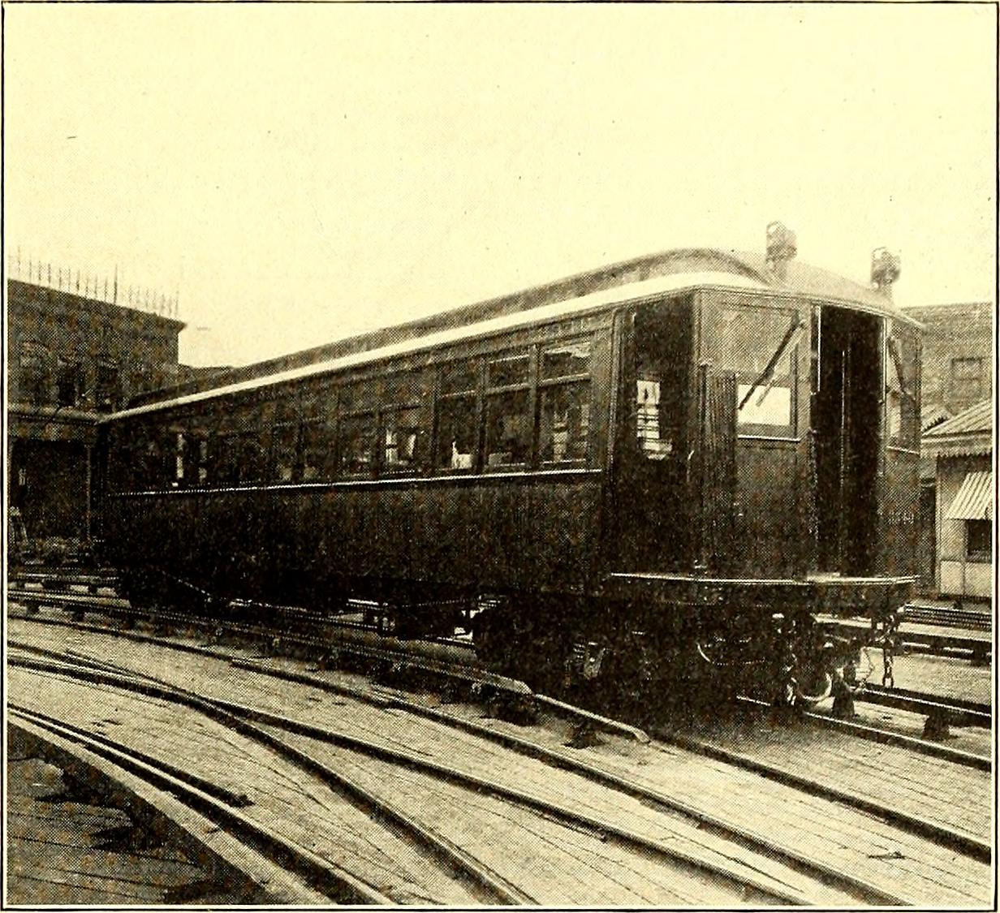

## מה זו בלימה רגנרטיבית ברכב חשמלי?

**בלימה רגנרטיבית** היא אחת הטכנולוגיות שהכי משנות את חוויית הנהיגה ברכב חשמלי. בקצרה: במקום לבזבז את אנרגיית ההאטה כחום בבלמים, המערכת הופכת את המנוע החשמלי לגנרטור שמייצר חשמל ומחזיר אותו אל הסוללה. התוצאה — הרכב מאט בעצמו ברגע שמרימים את הרגל מדוושת ההאצה, והאנרגיה ש"נזרקת" ברכב רגיל נאספת מחדש ומוסיפה טווח.

זו הסיבה שרכב חשמלי חסכוני במיוחד דווקא בנהיגה עירונית, שבה יש הרבה האטות ועצירות — בדיוק ההפך מרכב בנזין, שצורך יותר בעיר.

## איך זה עובד בפועל?

המנוע החשמלי יכול לפעול בשני כיוונים. כשמאיצים הוא צורך חשמל מהסוללה ומניע את הגלגלים. כשמרימים את הרגל או בולמים, התהליך מתהפך: הגלגלים מסובבים את המנוע, הוא מתפקד כגנרטור, יוצר התנגדות שמאטה את הרכב, והחשמל שנוצר זורם חזרה לסוללה.

ברוב הרכבים החשמליים יש שילוב חכם בין בלימה רגנרטיבית לבלמים ההידראוליים הרגילים. בהאטות עדינות ובינוניות עובדת בעיקר הרגנרציה, וכשצריך עצירת חירום או בלימה חזקה — נכנסים גם הבלמים הפיזיים.

### נהיגה בדוושה אחת

דגמים רבים מציעים מצב **נהיגה בדוושה אחת** (One-Pedal Driving). במצב זה עוצמת הרגנרציה חזקה מספיק כדי להביא את הרכב לעצירה מלאה רק על ידי שחרור דוושת ההאצה, בלי לגעת בכלל בדוושת הבלם. אחרי כמה ימי התרגלות, רוב הנהגים מתאהבים בשיטה — היא נוחה, חלקה ומפחיתה עייפות בפקקים.

טסלה הייתה מחלוצות השיטה, ואחריה הצטרפו יצרנים כמו ניסאן עם מערכת e-Pedal בדגם ליף, יונדאי וקיה עם בקרת רגנרציה בהגה, ורבים אחרים.

## כמה טווח הבלימה הרגנרטיבית באמת מצילה?

התשובה תלויה בסוג הנהיגה. בכביש מהיר ברמה קבועה כמעט אין האטות, ולכן התרומה קטנה. לעומת זאת בנהיגה עירונית עם עצירות תכופות, הרגנרציה יכולה לשחזר חלק ניכר מהאנרגיה ולשפר משמעותית את הטווח. בירידות ארוכות, כמו בכביש מהרי יהודה לעבר ים המלח, אפשר אפילו לראות את מד הסוללה מטפס בזמן הנסיעה.

מעבר לטווח, יש יתרון נוסף: **פחות בלאי**. מכיוון שהבלמים ההידראוליים עובדים הרבה פחות, רפידות הבלם והדיסקיות מחזיקים זמן רב בהרבה מברכב קונבנציונלי — חיסכון אמיתי בתחזוקה.

## השוואה: רמות רגנרציה נפוצות

| רמת רגנרציה | תחושת נהיגה | מתאים ל |
|---|---|---|
| נמוכה / גלישה חופשית | הרכב גולש כמו אוטומט בנזין | כביש מהיר, נהיגה חלקה |
| בינונית | האטה מורגשת בשחרור הדוושה | שימוש מעורב יומיומי |
| גבוהה / דוושה אחת | עצירה כמעט מלאה בלי דוושת בלם | נהיגה עירונית ופקקים |

ברוב הדגמים ניתן לכוונן את העוצמה דרך מסך המערכת, ובחלקם — כמו ביונדאי איוניק 5 ובקיה — ישירות באמצעות ידיות מאחורי ההגה, בדומה להחלפת הילוכים.

## טיפים לנהיגה חכמה עם רגנרציה

- **הסתכלו רחוק קדימה.** זיהוי מוקדם של רמזור או עצירה מאפשר להרים את הרגל בזמן ולתת לרגנרציה לעשות את העבודה, במקום לבלום חזק ברגע האחרון.
- **התאימו את העוצמה למצב.** בכביש פתוח העדיפו גלישה חופשית ליעילות מרבית; בעיר העדיפו רגנרציה חזקה.
- **שימו לב בחורף.** כשהסוללה קרה מאוד, הרכב מגביל זמנית את עוצמת הרגנרציה כדי להגן על התאים — תופעה נורמלית שחולפת כשהסוללה מתחממת.
- **זכרו את הרכב שמאחוריכם.** ברגנרציה חזקה הרכב מאט בלי שנוריות הבלם נדלקות בהכרח (בחלק מהדגמים הן כן נדלקות אוטומטית). שמרו מרחק ונהגו בהדרגתיות.

## שורה תחתונה

בלימה רגנרטיבית היא לא גימיק אלא יתרון מרכזי של הנהיגה החשמלית: היא מוסיפה טווח, מפחיתה עלויות תחזוקה והופכת את הנהיגה בעיר לנעימה ורגועה יותר. אם רכשתם לאחרונה רכב חשמלי או שוקלים כזה — תנו לעצמכם כמה ימים להתרגל לנהיגה בדוושה אחת. יש סיכוי טוב שלא תרצו לחזור אחורה.
